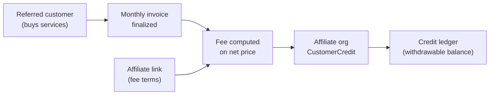
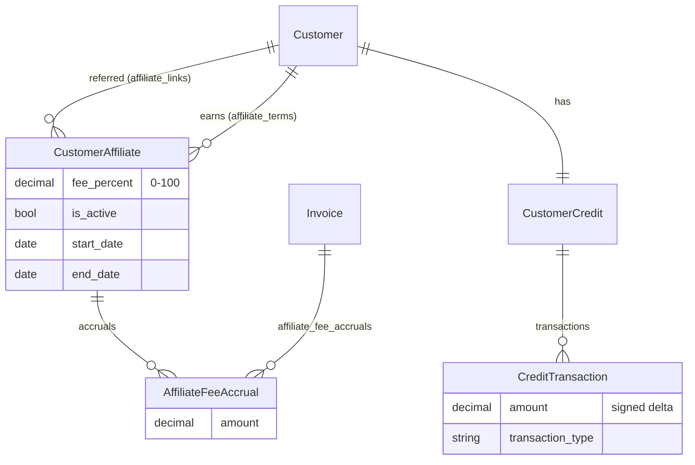
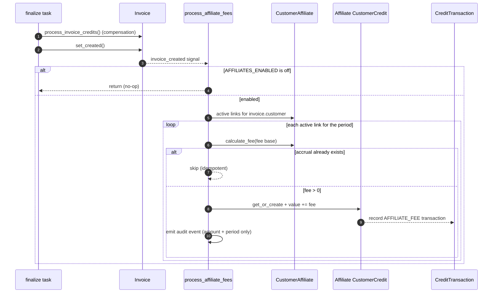
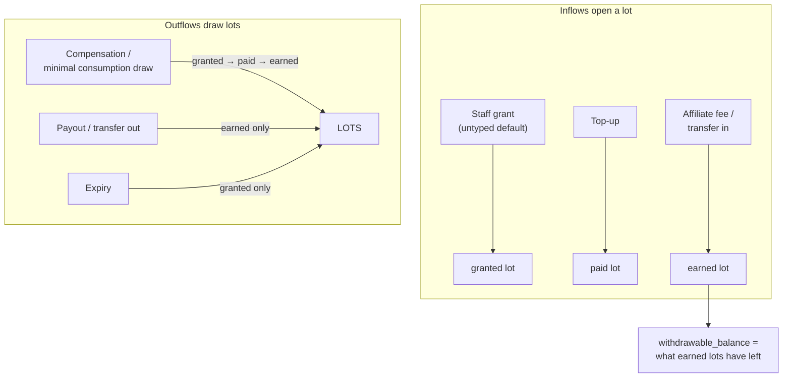

# Affiliate Program

## Overview

The affiliate program lets a staff operator reward one organization (the
**affiliate**) for business brought in by another organization (the **referred
customer**). Whenever a referred customer's monthly invoice is finalized, a
configurable **fee** is computed from the invoice and credited to the affiliate
organization's account. The fee lands in the affiliate's `CustomerCredit` and is
tracked in an append-only ledger so that the *earned* portion can later be paid
out or transferred, while granted credit cannot.

The whole program is **opt-in and disabled by default**. Configured links stay
dormant — and the API returns `404` — until it is switched on.



## Key concepts

| Term | Meaning |
|------|---------|
| **Referred customer** | The organization whose invoices generate fees (`CustomerAffiliate.customer`). |
| **Affiliate** | The organization that earns the fees (`CustomerAffiliate.affiliate`). |
| **Affiliate link** | A staff-configured `CustomerAffiliate` row binding the two, plus the fee terms. One link per `(customer, affiliate)` pair, and at most one active link per customer. |
| **Fee accrual** | An `AffiliateFeeAccrual` — one fee earned from one finalized invoice. Idempotent per invoice. |
| **Credit ledger** | `CreditTransaction` rows recording every change to a `CustomerCredit.value`. |
| **Credit lot** | A part of an organization credit by where the money came from: *granted* (staff grant), *paid* (customer prepayment recorded by staff) or *earned* (fees, transfers). See [Credit ledger](credit-ledger.md#credit-lots). |
| **Withdrawable balance** | What is left of the affiliate's *earned* lots — the only credit that may leave the platform. |

## Enabling the program

Two independent switches:

- **`AFFILIATES_ENABLED`** (runtime setting, default `False`) — the backend
  switch. It gates **both** the `customer-affiliates` API and fee accrual at
  invoice finalization. While off, the API responds with `404` and no fees are
  accrued, but existing links are preserved and resume once it is turned back on.
- **`reseller.affiliates`** (core feature flag) — controls **only** Homeport
  (frontend) menu and page visibility. It is *not* consulted by the backend.

Enable the backend in *Admin → Configuration → Settings → Affiliates → AFFILIATES_ENABLED*, or
programmatically:

```python
from waldur_core.configuration import config
config.AFFILIATES_ENABLED = True
```

## Data model



Each `AffiliateFeeAccrual` is unique on `(affiliate_link, invoice)`, which makes
accrual safe to re-run. It is also the *only* object that crosses the boundary
between the two organizations: it exposes the fee amount and the invoice period,
never the invoice contents.

## Fee

The fee is a single fixed percentage (`fee_percent`, 0–100) of the **fee
base**: the invoice net price — pre-tax and *post-compensation* — plus the part
of that compensation which the referred customer's **paid** credit covered:

```text
fee = (net_price + paid_compensation) × fee_percent / 100
```

A prepayment recorded by staff (`POST /api/customer-credits/{uuid}/top_up/`) is
revenue like any other payment, so an invoice settled from it still earns the
affiliate its fee. Granted credit is a discount and does not count. Usage
draws granted credit before paid credit, so a fee that a grant defers is
earned later, when the prepayment is spent.

`paid_compensation` is read from the lot draws of the invoice's latest
compensation run, net of tax like the price it is added to. A project credit
paying an earlier invoice onto this one (`historical_compensation`, see
`invoices/settlement.py`) lowers the net price too; the paid part of that
payment is added back, because it is revenue that the earlier month's invoice
already counted. A payment from granted credit is not added back, so it
lowers this invoice's fee, as a discount does — whether or not the earlier
month earned a fee on that cost.

The result is clamped to be non-negative. There is intentionally no per-invoice
fixed fee or formula — affiliate terms are deliberately simple. (For
quantity-driven *discounts* on what a customer pays, see
[Component dynamic discounts](component-discounts.md), a separate feature.)

## How a fee is accrued

Fee accrual rides on the existing invoice-finalization flow. The
`invoice_created` signal fires on the `PENDING → CREATED` transition, **after**
credit compensation has run, so the fee is computed on the final net price and
the final split of that compensation between paid and granted credit.



Robustness guarantees:

- **Never blocks finalization.** A broken formula or any per-link error is
  logged and skipped — the invoice still finalizes.
- **Idempotent.** Re-running finalization (grace periods, retries) does not
  double-accrue, thanks to the `(affiliate_link, invoice)` unique constraint.
- **Period-aware.** A link only accrues when `is_active` and the invoice period
  falls within `[start_date, end_date)`.

## Credit ledger and withdrawable balance

Every change to a credit balance — from any source, on an organization credit
or a project allocation — is recorded as a `CreditTransaction` row by a
`post_save` handler, typed by the flow that makes it and recorded as a **staff
grant** when untyped. On an organization credit each row also moves the
credit's **lots**; see [Credit ledger](credit-ledger.md) for both mechanisms.
What matters here is which lots hold *earnings*.



The **withdrawable balance** is what is left of the earned lots. Consequences:

- Granted and paid credit are **never** withdrawable.
- Earnings spent on the affiliate's own usage are gone for good: usage draws
  earned lots last, but once it has drawn them, a later grant does not
  make anything withdrawable again.
- Credit **expiry takes only granted credit**, so earnings survive the
  credit's end date.

Example — an affiliate with a 1000 grant earns a 30 fee:

| Event | `value` | `withdrawable_balance` |
|-------|--------:|-----------------------:|
| Staff grant of 1000 | 1000 | 0 |
| Affiliate fee of 30 | 1030 | 30 |
| Credit expires (granted → 0) | 30 | 30 |

The ledger is **append-only** — the lots are derived from it, so rows are never
edited or deleted; corrections are new rows. The one exception is
reconstructing history that predates the ledger, described in
[Backfilling the credit ledger](admin/credit-ledger-backfill.md).

## Worked scenarios

All amounts below are in the invoice currency and use the **fee base** — the
invoice net price (pre-tax, post-compensation) plus what paid credit
compensated. Fees are clamped to be non-negative
and rounded before they are stored.

### A. Flat percentage

`ResellerCo` refers `AcmeLabs`. Terms: `fee_percent = 10`.

| Month | Invoice net price | Fee (10%) |
|-------|------------------:|----------:|
| June  | 1,200.00 | 120.00 |
| July  | 800.00 | 80.00 |
| August | 0.00 | — (no accrual on a zero invoice) |

### B. Compensation reduces the base

Fees are computed *after* credit compensation has been applied to the invoice,
so any credit the referred customer spends shrinks the affiliate's fee too.

`AcmeLabs` receives a gross invoice of 1,000.00 and has 400.00 of its own credit
applied as compensation. Terms: `fee_percent = 10`.

| Step | Amount |
|------|-------:|
| Gross invoice | 1,000.00 |
| Credit compensation | −400.00 |
| **Net price (fee base)** | **600.00** |
| Fee (10 % of 600.00) | **60.00** |

The fee is 60.00, not 100.00 — the 400.00 was granted credit, a discount,
and the affiliate earns on what the customer actually pays.

### B2. A prepayment does not reduce the base

`AcmeLabs` prepaid 1,000.00 by bank transfer, which staff recorded with
`top_up`, and also holds a 150.00 grant. Its gross invoice is 1,000.00.
Usage draws the granted credit first, then the prepayment.
Terms: `fee_percent = 10`.

| Step | Amount |
|------|-------:|
| Gross invoice | 1,000.00 |
| Compensation from granted credit | −150.00 |
| Compensation from paid credit | −850.00 |
| Net price | 0.00 |
| **Fee base** (net price + paid compensation) | **850.00** |
| Fee (10 % of 850.00) | **85.00** |

The remaining 150.00 of the prepayment earns its fee in the month it is spent.

### C. Withdrawable balance over time

`ResellerCo` begins with a 1,000 grant from staff, then earns fees
over three months, takes a payout, and finally lets the credit expire. Only the
*earned* lots are ever withdrawable.

| Event | Ledger type | Δ value | `value` | Granted lots | Earned lots = `withdrawable_balance` |
|-------|-------------|--------:|--------:|-----------------:|-------------------------------------:|
| Staff grant | `staff_grant` | +1,000 | 1,000 | 1,000 | 0 |
| June fee | `affiliate_fee` | +120 | 1,120 | 1,000 | 120 |
| July fee | `affiliate_fee` | +80 | 1,200 | 1,000 | 200 |
| August fee | `affiliate_fee` | +150 | 1,350 | 1,000 | 350 |
| Payout to bank | `payout` | −200 | 1,150 | 1,000 | 150 |
| Credit expires | `expiry` | −1,000 | 150 | 0 | 150 |

Notes:

- The grant opens a granted lot and never adds to the
  withdrawable balance.
- The payout draws earned lots only.
- Expiry takes only the granted lots, so the 150 earned survives the end
  date.

### D. Period gating

A link with `start_date = 2026-03-01` and `end_date = 2026-07-01`. The window is
half-open: the start is inclusive, the end is exclusive (`date >= end_date` is
inactive).

| Invoice period | Accrues? |
|----------------|:--------:|
| February 2026 | No (before start) |
| March–June 2026 | Yes |
| July 2026 | No (end is exclusive) |

Setting `is_active = False` suspends accrual immediately, independent of the
dates, while keeping the link and its history.

### E. One active affiliate per customer

A customer has at most one active affiliate link. The partial unique constraint
`invoices_one_active_affiliate_per_customer` (unique `customer` where
`is_active` is true) enforces it, and the API rejects creating or re-activating
a second active link with `400`, naming the current affiliate. Inactive links
are not restricted and keep their accrual history.

The constraint follows `is_active`, not the date window: a link whose end date
has passed still counts until it is deactivated.

To move `AcmeLabs` from `ResellerCo` to `ConsultingX`:

1. Create the `ConsultingX` link with `is_active = False` and the start date
   of its first month.
2. Once the invoices for `ResellerCo`'s last month are finalized, deactivate
   the `ResellerCo` link. Deactivating stops accrual at once, even for a month
   that has not been invoiced yet.
3. Activate the `ConsultingX` link before the invoices for its first month are
   finalized; otherwise it earns nothing for that month.

A handover cannot be scheduled to happen by itself: both switches are manual.

Do not delete the old link instead. That deletes its accrual records and its
total earned; fees already credited stay in the affiliate's credit balance and
ledger, but no longer trace back to the link.

Links also stay unique per `(customer, affiliate)` pair, so moving `AcmeLabs`
back to `ResellerCo` later means deactivating `ConsultingX` and re-activating
the old link, not creating a new one.

!!! warning "Upgrading a deployment with several active links"
    Migration `invoices.0032` stops with the names of any customers that
    have more than one active link. Deactivate all but one link for each
    of them, then run the migration again.

## API

All endpoints live under `/api/customer-affiliates/` and return `404` while
`AFFILIATES_ENABLED` is off. Staff and global support see every link. Anyone
else sees the links whose affiliate is an organization they hold a role on:
owner, support or reader alike. A role on its service provider or projects
does not count, and the referred customer sees none of them. HomePort shows
the *Affiliate earnings* page to the same people.

| Method & path | Who | Purpose |
|---------------|-----|---------|
| `GET /api/customer-affiliates/` | staff, support, affiliate organization roles | List links (affiliates see only their own). |
| `POST /api/customer-affiliates/` | **staff only** | Create a link. |
| `GET /api/customer-affiliates/{uuid}/` | staff, support, affiliate organization roles | Retrieve a link. |
| `PATCH/PUT /api/customer-affiliates/{uuid}/` | **staff only** | Update fee terms. |
| `DELETE /api/customer-affiliates/{uuid}/` | **staff only** | Remove a link and its accruals. |
| `GET /api/customer-affiliates/{uuid}/accruals/` | staff, support, affiliate organization roles | Per-invoice fees (amount + period only). |
| `GET /api/customer-affiliates/{uuid}/earnings/` | staff, support, affiliate organization roles | Lifetime total, per-month series, withdrawable balance, and the fee the current month is expected to earn. |

Validation on create/update:

- An organization cannot be its own affiliate.
- `fee_percent` must be between 0 and 100.
- `end_date` must be after `start_date`.
- A customer can have only one active link. Creating an active link, or
  setting `is_active` to true, while another link is active returns `400`
  naming the current affiliate.

### Example: create a link (staff)

```http
POST /api/customer-affiliates/
{
  "customer":  "https://waldur.example.com/api/customers/<referred-uuid>/",
  "affiliate": "https://waldur.example.com/api/customers/<affiliate-uuid>/",
  "fee_percent": 10
}
```

### Example: earnings summary

```http
GET /api/customer-affiliates/<uuid>/earnings/

{
  "total_earned": "30.00000",
  "withdrawable_balance": "30.00000",
  "per_month": [{"year": 2026, "month": 6, "amount": "30.00000"}],
  "upcoming": {"year": 2026, "month": 7, "amount": "12.40000"}
}
```

`upcoming` is the fee the current month is expected to earn: the accrual rule
applied to the referred customer's open invoice as it stands. It uses the same
fee base as an accrual: the invoice's net price after the estimated volume
discounts (see [Component discounts](component-discounts.md)) and after the
credit that month close is expected to draw, plus the part of that draw that
paid credit covers. Usage draws granted lots first, then paid ones, from the
lots as they stood when the month began. It changes until the month closes, and
becomes an accrual only then. A payment of an earlier invoice from credit, which month
close may also write, is not projected. `upcoming` is `null` when the link is
not active on the first day of the month, when the referred customer has no
open invoice, or when the month would earn nothing. Like an accrual, it carries
the period and amount only.

## Privacy model

The program is designed so an affiliate **never** sees what the referred
customer bought:

- Members of the affiliate organization, whatever their role there, get
  **read-only** access to its links, accruals and earnings. They cannot view
  the referred customer's invoices (those return `404`).
- The accrual representation exposes the fee `amount` and the invoice
  `year`/`month` only — never a link or embed of the `Invoice` object.
- Audit events for earned fees carry the period and amount only, scoped to the
  affiliate organization.
- The amounts still reveal totals, not contents. An accrual is `fee_percent` of
  a closed invoice's net price, so it shows that month's total. `upcoming` does
  the same for the open month, and it follows the running total as the month
  goes on.

## Audit events

| Event type | When | Scope |
|------------|------|-------|
| `create_of_affiliate_by_staff` | A link is created | Affiliate org |
| `update_of_affiliate_by_staff` | Link terms change | Affiliate org |
| `increase_of_customer_credit_due_to_affiliate_fee` | A fee is accrued | Affiliate org |

All three belong to the `CREDITS` and `CUSTOMERS` event groups.
