# Waldur Proposal Module

The Waldur proposal module provides a comprehensive research proposal management system that enables institutions to manage competitive resource allocation through structured calls for proposals, peer review processes, and automated resource provisioning.

## Architecture Overview

The proposal system follows a **Call → Round → Proposal → Review → Allocation** architecture that handles the complete lifecycle from call publication to resource delivery:

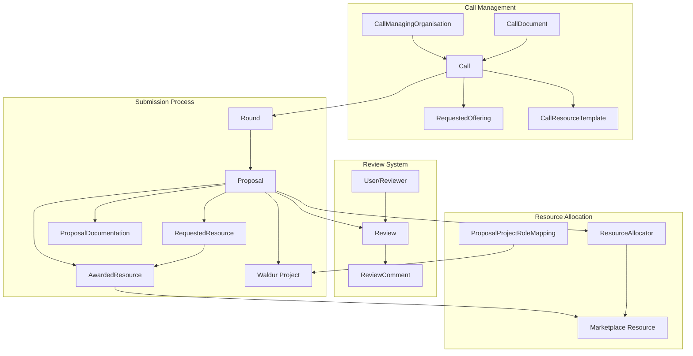

### Core Models

- **`CallManagingOrganisation`**: Organizations that create and manage calls for proposals
- **`Call`**: Main entity representing calls with configuration for review settings and duration
- **`Round`**: Time-bounded submission periods, with a lifecycle after the cut-off (evaluating → deciding → results published → closed)
- **`CallWorkflowStep`**: A step of a call's evaluation workflow — ordered, named, of a code-defined kind, and how it is gated
- **`Proposal`**: Individual proposals with project details and resource requests
- **`RequestedResource`**: Specific resource requests within proposals linked to marketplace
- **`AwardedResource`**: What the allocation decision grants; starts as a copy of the requests and is what allocation provisions
- **`Review`**: Peer review system with scoring, comments, and field-specific feedback

## Call Lifecycle and State Management

### Call States

Calls progress through a simple but effective state machine:

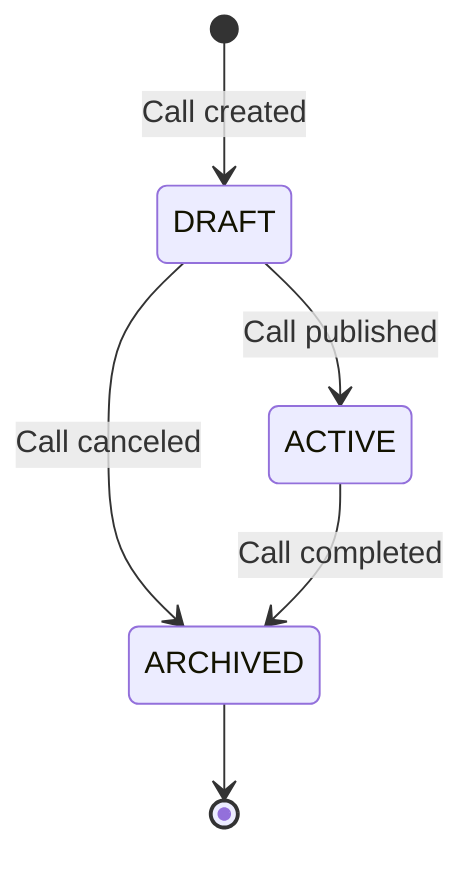

#### Call State Descriptions

| State | Description | Operations Allowed |
|-------|-------------|-------------------|
| **DRAFT** | Call being prepared by organization | Edit call details, add rounds, configure offerings |
| **ACTIVE** | Call open for submissions | Submit proposals, manage reviews, allocate resources |
| **ARCHIVED** | Call completed or canceled | View historical data, generate reports |

### Proposal States

Proposals follow a comprehensive lifecycle with review integration:

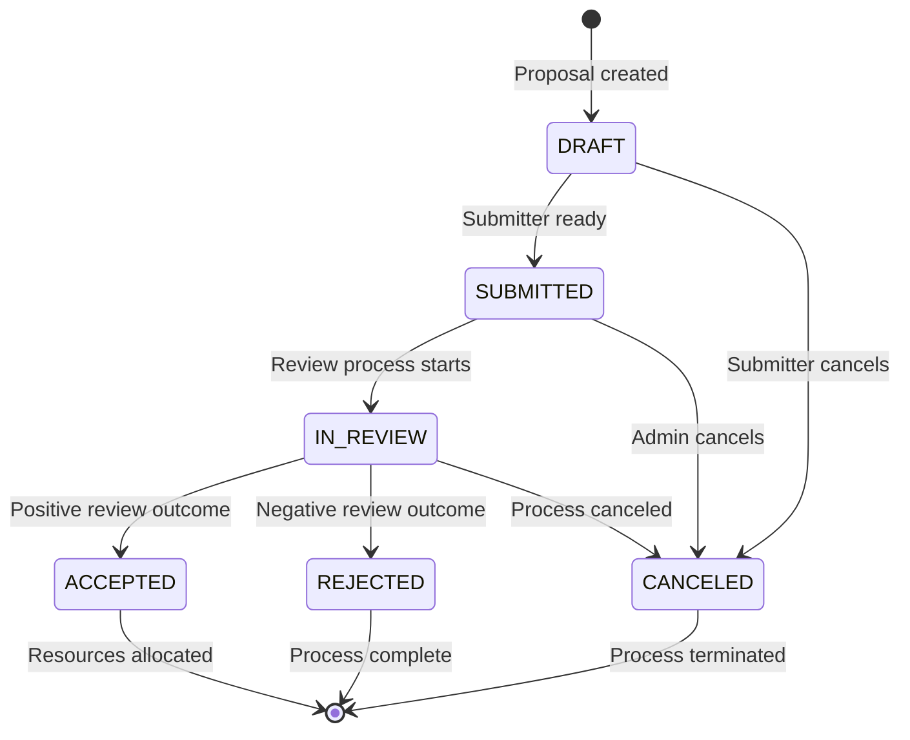

A decision held for its round's publication (see
[Held decisions](#publishing-results-and-held-decisions)) does not change the
state: the proposal stays `IN_REVIEW` with `decision_held=True` until the round's
results are published, and only then moves on as the decision says.

#### Proposal State Descriptions

| State | Description | Triggers | Actions Available |
|-------|-------------|----------|-------------------|
| **DRAFT** | Proposal being prepared | User creation | Edit, add resources, upload docs |
| **SUBMITTED** | Proposal submitted for review | User submission | View, withdraw |
| **IN_REVIEW** | Under review by experts | System/admin trigger | Review, comment, score |
| **ACCEPTED** | Approved for resource allocation | Review completion | Allocate resources, create project |
| **REJECTED** | Declined after review | Review completion | View feedback, appeal |
| **CANCELED** | Withdrawn or administratively canceled | User/admin action | Archive |

#### The applicant team

The applicant is the proposal's team as it stands: everyone holding an active
role on the proposal (`PROPOSAL.MANAGER`, `PROPOSAL.ADMIN`, `PROPOSAL.MEMBER`).
Nothing is granted through `created_by`: the author is on the team only while
they still hold one of those roles, and once removed reads, edits and submits
nothing of it.

- **Who acts for the applicant.** A step the applicant completes -- the
  response to reviews, the award response -- is completed by any current
  proposal manager. The other members read it. Nobody on the team rejects the
  proposal at such a step; a rejection is the call's.
- **The team is frozen once the award is accepted.** Adding, removing or
  changing a team role, and inviting to the team, are refused from then on,
  staff included: the people are managed on the awarded project.
- **Joining the team ends evaluating.** Whoever joins the team of a proposal
  they evaluate is treated as for a recorded conflict of interest: their
  evaluator role on it is revoked ("Joined the applicant team."), a review in
  progress is rejected, assignments not yet answered are blocked and their open
  contributions are withdrawn. The access checks refuse team members on their
  own as well, so an offering manager on the team no longer fills their
  offering's technical assessment, and a panel member on the team reads the
  proposal as an applicant.

### Review States

Reviews maintain independent state for tracking progress:

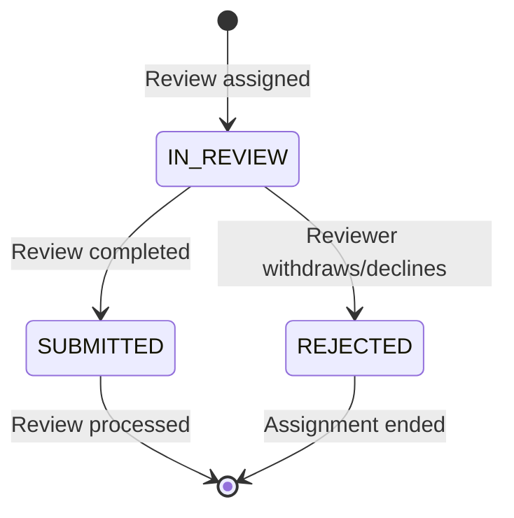

## Rounds and Evaluation Policy

### What a round holds

A round is a submission window. Its scheduling fields are:

| Field | Meaning |
| --- | --- |
| `start_time` | Submissions open |
| `cutoff_time` | Submissions close |
| `review_duration_in_days` | How long an individual review may stay open before it expires |
| `allocation_date` | The date granted projects start when the allocation decision uses a fixed date |

A round's status (`scheduled`, `open`, `ended`) is derived from `start_time` and
`cutoff_time`; it is not stored. Proposals can be created and submitted only while
their round is open. After the cut-off the round has a stored lifecycle, described
in [Round lifecycle after the cut-off](#round-lifecycle-after-the-cut-off).

When evaluation starts is the call's `evaluation_start`:

- `on_submission` (default) — submitting creates the proposal's workflow step
  instances and activates the first enabled step at once.
- `at_cutoff` — every proposal stays `submitted` until its round's cut-off; an
  hourly task (`start_evaluation_for_closed_rounds`) then starts them together,
  so a round is evaluated as one batch. It cannot be changed while the call has
  proposals that are submitted or in review.

A round can be deleted only while it has **no proposals at all**, in any state.
Rejected and cancelled proposals are outcomes of the round and keep it; deleting
the round would delete them with it. `ProtectedRoundSerializer.has_proposals`
tells clients whether deletion is possible; it counts every proposal, including
those the viewer cannot see.

### Panels

A call may route its proposals to panels (`CallPanel`: `key`, `name`,
`description`, `order`, `chair`, `members`, `science_domains`,
`science_sub_domains`), such as the Domain Panels of Regular Access. They are
managed at `/api/proposal-protected-calls/{uuid}/panels/` by whoever may update
the call, and read by them and by the call's panel members; not by its
reviewers.

- Members must hold the call's panel member role, and the chair must be a
  member. Losing the panel member role takes the user off the call's panels
  and clears them as chair.
- Within a call no science domain, and no sub-domain, is mapped to two panels.
- When a proposal's evaluation starts (on submission or at the cut-off) it
  goes to the panel mapping its sub-domain, else the panel mapping that
  sub-domain's domain, else to none. The routing is logged as
  `proposal_panel_changed`.
- `POST /api/proposal-proposals/{uuid}/set_panel/` moves a submitted proposal.
  Allowed to those who manage the call and to the completer of the
  proposal's running assignment step that assigns a panel-based role (the
  call's panel chair in Regular Access); never to the applicant team. The
  panel chair the workflow assigned, while they have done nothing on the
  proposal yet, is revoked with the move ("Moved to panel X.") and told so,
  and a running assignment step assigns the new panel's chair. Any other
  holder of a panel-based role -- assigned by hand, or a chair who has
  contributed, completed a step, assigned someone or requested changes --
  refuses the move with the reason: revoke them first. Logged as
  `proposal_panel_changed`.
- Two evaluator role eligibilities follow the panel: `panel:chair` (the chair
  of the proposal's panel) and `panel:member` (its members). Staffing warnings
  on the role count the call's smallest panel.
- When an assignment step starts, each of its roles with `panel:chair` and at
  most one holder is given to the proposal's panel chair, who confirms having
  no conflict of interest when the step asks for it. A chair who cannot take
  the proposal is not assigned, and the step says why.
- `panel_uuid` and `panel_name` on a proposal are shown to whoever sees who
  evaluates it, never to the applicant team. Proposals and rankings filter by
  `panel_uuid`.
- A panel with proposals cannot be deleted. Panels travel with exports,
  imports and duplicates of the call by the code and name of each domain,
  without their chair and members. On import a domain is matched by both: one
  whose code this portal gives another name is skipped with a warning, so a
  portal with another taxonomy never routes a panel to the wrong domains.
  Older documents that give codes alone are matched by code, with a warning.

### Where evaluation policy lives

Review and allocation policy is configured per call, on its workflow steps
(`CallWorkflowStep`). The call manager composes the workflow from ordered,
named steps, each of one of four code-defined kinds, and a kind may appear any
number of times:

| Kind | Behaviour | Outcome sets |
| --- | --- | --- |
| `applicant_action` | The applicant fills in a form or answers, e.g. accepts the award | `submitted`, `acceptance`, `done` |
| `assignment` | Someone picks the people who act later | `done` |
| `assessment` | Assigned people assess, e.g. technical assessment, peer review | `reviewed`, `feasibility`, `done` |
| `decision` | One completer picks an outcome, e.g. eligibility, panel, allocation | `approval`, `eligibility` |

`GET /api/proposal-protected-calls/workflow_step_kinds/` lists the kinds with
their outcome sets, default completer and the step fields that apply to them.
A proposal walks its call's enabled steps by `order`; a negative outcome
(`ineligible`, `infeasible`, `declined`) rejects it, or cancels it on a step
with `on_negative=cancel`, and passing the last step allocates it.

| Setting | Meaning |
| --- | --- |
| `key`, `name`, `description` | Identifier within the call (fixed once created), and what the call manager calls the step |
| `kind`, `outcome_set` | Behaviour of the step, and which of its kind's outcome sets it is completed with |
| `order` | Position in the workflow; inserting at a taken position moves the later steps down |
| `on_negative` | `reject` (default) or `cancel` the proposal on a negative outcome |
| `is_allocation_decision` | The decision step that settles the award; a call is activated with exactly one enabled |
| `is_enabled` | Whether the step runs; the allocation decision cannot be disabled |
| `duration_in_days` | Step deadline, counted from when the step starts |
| `completer` | Who acts on the step (call manager, offering manager, reviewer, panel member, applicant) |
| `checklist`, `checklist_required` | Evaluation form for the step, and whether it must be answered |
| `min_reviewers`, `min_score_threshold` | Completion gates: the step cannot be completed until enough reviews are in and their average reaches the threshold. They never decide on their own |
| `blind_review`, `requires_coi_confirmation` | Evaluator isolation and conflict-of-interest attestation |
| `applicant_visible` | Whether the applicant sees the step |
| `transition_mode` | `automatic_on_completion` advances to the next step when this one is completed; `manual` waits for a separate advance |
| `include_award_response`, `allocation_time` | On the allocation decision only: whether the applicant must accept the award (an `award_response` step right after it), and whether allocation happens `on_decision` or on the round's `allocation_date` (`fixed_date`) |

A new call is seeded with the steps that were once a fixed catalogue, in order:
`administrative_check`, `technical_assessment`, `expert_review`,
`panel_review`, `allocation_decision`; `award_response` is added by
`include_award_response`. For one release the API keeps the old names as
aliases: `step` for `key` (read and write), `responsible_role` for
`completer`, and `?step=<key>` next to `?step_uuid=` on the step checklist
actions.

Each step also carries notification rules (`CallWorkflowStepNotificationRule`):
on a trigger (`step_started`, `step_completed`, `step_rejected`,
`step_expired`, `deadline_approaching`) mail an audience. A rule addressed to
the applicant (or to the responsible role of a step the applicant
completes) lists in `notified_proposal_roles` the proposal roles whose
holders are told, for example only `PROPOSAL.MANAGER`. Left empty, it reaches
the proposal's whole team as it stands. The applicant side gets one message
with every recipient in To; other audiences get a private copy each.

`contribution_submitted` fires once per contribution handed in (an offering's
assessment, a review, a report, again after it was reopened). Its mail never
names who handed it in; recipients who read the step's dashboard labels are
told how many contributions are in, the applicant is not.

A call copies the holders of the proposal roles in `Call.applicant_cc_roles`
(for example `PROPOSAL.MANAGER`, the principal investigator, and
`PROPOSAL.ADMIN`) on every mail to the applicant: state changes, step mails to
the applicant, requests for changes, cancellation and deadline reminders. Only
the proposal's current team is copied, each address once, and never on mail
to any other audience.

A step's `status_labels` name it per audience: `applicant`, `evaluators`,
`call_team` (call managers, staff and support) and `offering_team` (the
offering teams, on the steps they work on). The call team's and the offering
teams' labels fall back, state by state, to the evaluators'. Labels other than
the applicant's may show counts of the step's work: `{invited}`, `{accepted}`,
`{declined}`, `{submitted}`, `{expected}`, `{reports_submitted}`,
`{reports_expected}`; any other placeholder is refused.

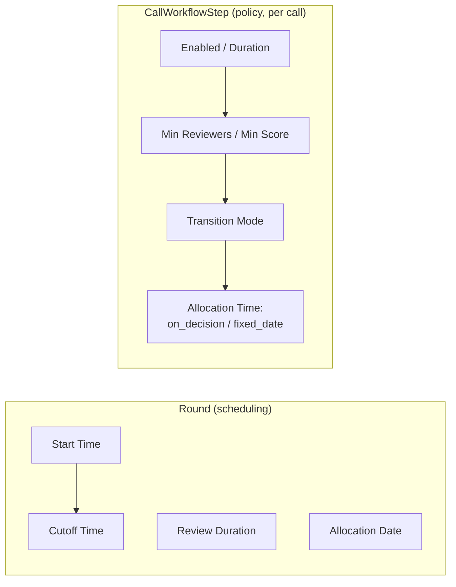

### How long a granted project runs

When a proposal is allocated, the project's end date is decided in this order:

1. **The call's fixed duration** (`Call.fixed_duration_in_days`), whenever it is set.
   Prepaid subscription lengths requested under the call are capped to fit inside
   it, and resource end dates are clamped to the project's.
2. **The longest awarded prepaid subscription**, when the call sets no fixed
   duration — measured over the proposal's `AwardedResource` rows once the award
   exists (see [Awarded resources](#awarded-resources)), and over its requests
   before that.
3. **No end date**, when neither applies: the project runs until someone sets one.

## Round Lifecycle and Results Publication

### Round lifecycle after the cut-off

Before its cut-off a round has no stored state. Once the cut-off has passed,
`Round.lifecycle_state` (`RoundLifecycleStates`) records where the round stands:

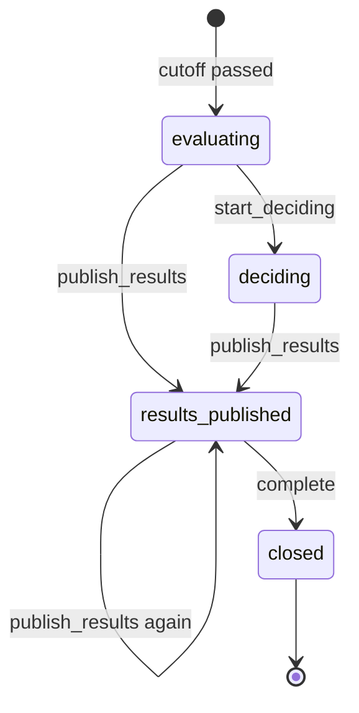

`evaluating` is entered by `utils.start_round_evaluation`, a conditional update
that exactly one caller wins: the hourly tasks
`proposals_for_ended_rounds_should_be_cancelled` and
`start_evaluation_for_closed_rounds`, closing a round early (`close_round`), and
the first lifecycle action on an ended round that the sweep has not reached yet.
The other transitions are call-manager actions in `round_lifecycle.py`, exposed
on `ProtectedCallViewSet`:

| Action | Endpoint (POST) | Transition |
| --- | --- | --- |
| Start deciding | `/api/proposal-protected-calls/{uuid}/rounds/{round_uuid}/start_deciding/` | `evaluating` → `deciding` |
| Publish results | `/api/proposal-protected-calls/{uuid}/rounds/{round_uuid}/publish_results/` | `evaluating`/`deciding` → `results_published`; retries held decisions in `results_published` |
| Complete | `/api/proposal-protected-calls/{uuid}/rounds/{round_uuid}/complete/` | `results_published` → `closed` |
| Record adoption | `/api/proposal-protected-calls/{uuid}/rounds/{round_uuid}/record_adoption/` | No transition; any time after the cut-off, or only in `deciding` when the call requires adoption |

All four take the permissions of `close_round` (`CLOSE_ROUNDS` on the call or
its managing organisation) and require an active call. Each transition records
its timestamp (`evaluation_started_at`, `deciding_started_at`,
`results_published_at` with `results_published_by`, `closed_at`) and emits an
event (`round_evaluation_started`, `round_decision_started`,
`round_results_published`, `round_closed`) against the managing organisation.
These fields are the round's own history: duplicating, exporting or importing a
call starts its rounds without them (`Round.LIFECYCLE_FIELDS`).

### Publishing results and held decisions

`Call.publish_results` (`ResultsPublication`) decides when an applicant learns
the allocation decision:

- `immediately` (default) — each decision is announced and carried out as it is
  made.
- `with_round` — a decision on `allocation_decision` (completion, rejection or
  expiry) is recorded on its step instance, but `Proposal.decision_held` is set
  and nothing else happens: no step notification, no state change, no award
  response step, no allocation. `Round.withholds_results` is true while the call
  is `with_round` and the round is neither `results_published` nor `closed`.
  The decision locks the round row, so a decision and the round's publication
  serialise.

`publish_results` releases every held decision of the round through
`workflow_service.release_held_decision`, as if it had just been made:
negative outcomes reject the proposal, a lapse goes where an unheld lapse goes,
an approval continues to `award_response` or, at the end of the workflow,
accepts and provisions. The applicant gets the notification an immediate
decision would have sent. A manual `transition_mode` does not park a released
decision again: publication is the call manager's confirmation.

- **Undecided proposals.** On a `with_round` call, publishing is refused with
  `400` and `undecided_count` while a proposal of the round is under evaluation
  with neither a held nor a taken decision. Sending `force: true` with a
  non-empty `reason` publishes anyway; the reason is stored as
  `Round.results_forced_reason`, and the undecided proposals are announced as
  they are decided.
- **Partial failure.** Each decision is released in its own savepoint. One that
  fails (an allocation that cannot be provisioned, say) is rolled back, stays
  held and is listed in `failed_proposals`; publishing again retries it.
- On an `immediately` call nothing is held, so publishing only records the
  lifecycle.

`publish_results` cannot change while the call holds decisions
(`Call.has_held_decisions()`); switching would not release them.

**Reopening.** `POST /api/proposal-proposals/{uuid}/reopen_decision/` with a
required `reason` and an optional future `deadline` takes a held decision back
(`workflow_service.reopen_held_decision`). The decision step becomes active
again with its outcome cleared, `decision_held` is unset, and the proposal
counts as undecided when the round publishes. Without a `deadline`, one that
has passed is cleared and one still ahead is kept. It is refused with `409` once
the round's results are published or when there is no held decision. Allowed
for staff and holders of `UPDATE_CALL` on the call or its managing organisation,
but never for the proposal's own applicant (`user_can_manage_held_decision`).
Nothing is sent. A `proposal_decision_reopened` event is filed on the
proposal's feed only, carrying the actor and the deadline but neither the
reason nor the outcome taken back; those go to the server log.

**Who sees a held decision.** `user_can_view_held_decision`: staff, support,
and holders of `UPDATE_CALL` on the call or its managing organisation who are
not the proposal's applicant. For everyone else:

- `ProposalSerializer.decision_held` and `ProtectedRoundSerializer.held_decisions_count` are `null`;
- the decision step instance is serialised as still `active`, without outcome,
  reason or completer;
- the `proposal_decision_reopened` event is hidden, through an event-type guard
  (`logging.utils.register_event_type_guard`) that applies to event listings and
  hook delivery alike, until the round's results are published. Evaluators never
  read the proposal feed at all.

`held_decisions_count` counts the round's held decisions; after publication it
counts only those whose release failed.

### Completing a round

`complete` closes a `results_published` round. It is refused with `400` and
`held_decisions_count` while a decision of the round is still held (its release
failed; publish again). Proposals still without a decision follow
`Round.undecided_at_completion_rule` — the round's own
`undecided_at_round_completion`, or else the call's (`UndecidedAtRoundCompletion`):

- `refuse` (default) — completing is refused with `400` and `undecided_count`.
- `reject` — `workflow_service.reject_undecided` rejects each at the step it
  stands in, with the reason "Not decided when the round was completed." and the
  step's rejection notifications. A proposal parked on a completed step waiting
  for a manual advance is rejected on the step it was waiting to enter; one whose
  workflow has not started is rejected outright. Each rejection emits
  `proposal_rejected_at_round_completion`, and the batch emits
  `round_undecided_proposals_rejected`. The response lists `rejected_proposals`;
  a rejection that fails is listed in `failed_proposals`, and the round stays
  open until completing again rejects what is left.

### Adoption record

`record_adoption` (multipart) stores `adopted_at` (required), `adoption_note`
and an optional `adoption_document` — for results that a board or another body
must adopt. While the round withholds its results, `adoption_note`,
`adoption_document` and `results_forced_reason` serialise as `null` for anyone
who may not see held decisions (`user_can_view_round_adoption`), and the media
endpoint applies the same rule to the document. Writing the record follows the
same rule: while the round withholds its results, a holder of `CLOSE_ROUNDS`
who may not read the record gets `403`, so no one saves over a note they were
never shown.

`Call.adoption_required` makes the adoption a gate between the decision body
and the applicants, as when a governing board adopts the allocation list:

- `record_adoption` is accepted only while the round is `deciding`.
- `publish_results` is refused with `400` until `adopted_at` is set. `force`
  does not bypass it: it answers for undecided proposals only.
- Once adopted, a held decision can no longer be reopened (`409`).
- The first recording emits `round_results_adopted` against the managing
  organisation and mails the call managers (`proposal.round_results_adopted`):
  the date and who recorded it, never the note. Correcting the record later
  does neither.

### Steps run once per round

A step with `round_scoped` -- a panel meeting, a committee's ranking, the
adoption of a ranking list -- runs once for the round's proposals rather than
on each. It is an assessment or a decision, never the allocation decision,
not per requested offering, without minimum or maximum contributions, score
threshold, delegation, reviewer suggestions or change requests, and its
contributors are nobody, the holders of an evaluator role
(`proposal_role:<id>`) or of a call role (`call_role:<role>`, such as the
panel chair and vice-chair). The call evaluates at the cut-off.

- A proposal reaching it stands at it with nothing to do: no contribution,
  no per-proposal start mail, no expiry one by one, and it is not completed
  on its own (`400`). A call manager can still reject it there.
- `rounds/{uuid}/open_workflow_step` (`UPDATE_CALL`) opens it for the round.
  It is refused while a proposal of the round has not reached the step
  (`lagging_count`), unless forced with a reason. The proposals parked just
  before it are moved in, each committed on its own, and each contributor
  gets one round report -- a `RoundMeetingNote` with the step -- covering
  the proposals they hold the step for, and one mail
  (`proposal.round_report_requested`); the call managers get one
  (`proposal.round_step_opened`). A proposal arriving later joins its
  author's draft.
- A round report is written by its author: notes, documents, the step's
  form (`checklist` / `submit_answers` on the note) and a ranking within the
  report (`ProposalRanking.meeting_note`, ranks unique per report). `submit`
  fixes it; `reopen` (call managers) hands it back so a late proposal joins.
  Once every report covering a proposal is in, an assessment step is
  completed for it with `done`. A decision step is completed for the round
  with `complete_workflow_step`, which the step's completer -- the panel
  chair, say -- may use too.
- A report and its ranking are read by staff, support, the call's managers,
  the author and those working on a later step that reads the round step on
  a covered proposal; never by anyone on the team of, or in conflict with,
  any proposal it covers. The round's overall ranking stays as it was, and
  the call's panel chair and vice-chair may write it as well.

`RoundStep.due_at` (`rounds/{uuid}/set_workflow_step_due_date`) sets when any
step is due in a round, for every proposal; the proposals at the step get the
new deadline and their reminders again. `rounds/{uuid}/advance_workflow_step`
moves on every proposal of the round parked on a completed manual step, such
as a technical assessment the call managers check before it moves on. The
round's `round_steps` field lists each step's due date, proposals before, at
and after it, and the state of its reports.

## Checking a Workflow and Its History

### Workflow check before activation

`GET /api/proposal-protected-calls/{uuid}/workflow-check/` runs a registry of
rules (`proposal/workflow_checks.py`) over the call's workflow description.
Each finding has a stable `code`, a `severity`, the `step` it concerns (null
for the call) and the `field` that fixes it, so the UI can open that setting.

- **Errors** mean the call cannot run as configured: no round, no enabled step,
  no or several allocation decisions, an award response before the decision,
  an unguarded automatic decision, an applicant step without a form, no
  accepted offering or an offering without a plan (the checks activation always
  made, with the same messages), and a completer, contributor or delegation
  target nobody can hold, a run condition naming a missing or later step or an
  outcome that ends the proposal first, an input read from the same or a later
  stage, a decision or applicant step inside a parallel stage, and a
  notification rule that can never reach anyone.
- **Warnings** never block: durations up to the decision longer than the
  round's time to decision (allocation date minus cut-off, else the call's
  `target_decision_days`, else the review duration), steps without a duration,
  a negative outcome that changes nothing, blind review released with reviewer
  identities shown, an empty reviewer pool, notification gaps, and the
  domain-panel and round-step rules once those features are configured.
- **Info**: roles the call managers assign by hand, and each step that differs
  from the template the call was created from.

`activate` runs the same check and refuses the call with every error at once,
as `{"detail": ..., "workflow_check": [...]}`. There is no override.
`GET /api/call-templates/{uuid}/workflow-check/` runs the document-only rules on
a template. Both endpoints have the workflow description's audience: the call's
team, staff and support; panel members, reviewers and applicants get 404.

### Template link and version history

A call created from a template keeps `template` and `template_version`.
`CallTemplate.version` increases whenever the template's document changes;
name, description and publication leave it alone.

Every write that changes what the call exports as its settings and workflow
(call settings, steps, evaluator roles, notification rules, role
mappings, review configuration, activation) records a `WorkflowVersion` once it
commits, only when the document changed. While the call is a draft, one user's
versions within 15 minutes merge into one; after activation every version is
kept. A call created from a template starts with the template's document as
version 1 and its own export as version 2, so import normalisation shows once.
Calls created before versions were kept get their current state as version 1
the first time they are written to or their history is read.

- `GET .../workflow-versions/` and `.../workflow-versions/{number}/`;
- `GET .../workflow-diff/?from=<n|template|template_latest|current>&to=<...>`:
  changes keyed by step key, field by field, each `behaviour` or `cosmetic`
  (names, descriptions, help texts); a step counts as moved only when its place
  relative to the other steps changed.

The same pair exists on `call-templates/{uuid}/` for staff.

## Resource Template System

### Template Architecture

Call resource templates standardize resource requests across proposals:

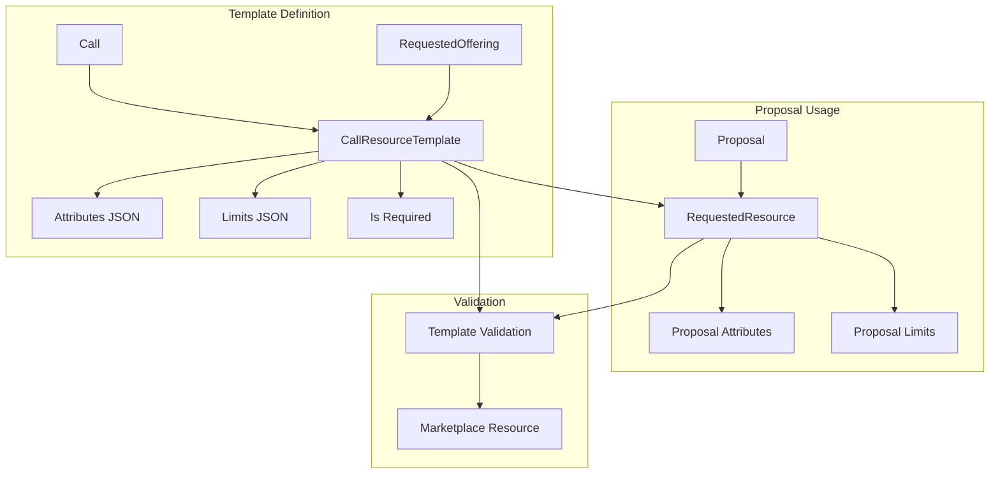

### Template Configuration Example

```python
# Template for HPC compute allocation
{
    "name": "Standard HPC Allocation",
    "attributes": {
        "cluster": "hpc-production",
        "partition": "general",
        "max_walltime": "72:00:00"
    },
    "limits": {
        "cpu_hours": {"max": 100000, "default": 10000},
        "gpu_hours": {"max": 5000, "default": 0},
        "storage_gb": {"max": 1000, "default": 100}
    },
    "is_required": True
}
```

### Template Rules

Once a call has at least one resource template, templates are the only way to
request resources in it. `RequestedResourceSerializer` enforces this when a
request is created or changed:

- A direct request (`requested_offering_uuid`) is refused.
- A request made from a template (`call_resource_template_uuid`) takes the
  template's `limits` and `attributes`; different values are refused on create,
  and changing them later is refused. The template's offering must be accepted
  by the provider.
- A template can be requested at most once per proposal.

`Call.resource_template_selection_mode` sets how many templates a proposal may
hold:

| Mode | Rule |
|------|------|
| `multiple` (default) | any combination of the call's templates |
| `single` | exactly one: a second request is refused, and a proposal cannot be submitted without one |

Switching a call to `single` is refused while a draft proposal holds several
requests. Requests are created under a lock on the call row, which the switch
takes too, so neither can slip in between the other's check and its write.

Saving a template validates its attributes against the offering's options and
its prepaid duration against the offering's terms. Editing a template updates
the requests made from it on **draft** proposals; submitted proposals keep the
values they were submitted with. `utils.template_request_values()` defines the
values a template request carries, for creation, this sync and the submit check.

`Proposal.resource_template_error()` reports what breaks these rules, and both
`can_submit` and the submit action use it (submit checks again under the
proposal lock): requests not made from a template, templates whose offering is
no longer accepted, duplicates, the `single` mode count, and requests whose
values no longer match their template. This catches drafts from before the
rules, requests whose template was deleted, and calls that gained templates
after a draft was started.

`is_required` is stored on a template but not enforced: a proposal can be
submitted without a template marked as required.

## Review System Architecture

### Reviewer registry and standing

The platform operator decides who may review, through the staff-only
reviewer registry (`/api/reviewer-registry/`, Administration → Call
management → Reviewers in the UI).

Each reviewer profile has a **standing**:

| Standing | Meaning |
|---|---|
| `active` | The default. Selected for, invited to and offered review work as usual. |
| `suspended` | Temporarily kept from new review work; meant to be lifted. |
| `blocked` | Kept from new review work until staff decide otherwise. |

Staff set the standing with `POST /api/reviewer-registry/{uuid}/set-standing/`
(`{"standing": ..., "reason": ...}`; a reason is required unless the standing
is `active`). The profile records who changed it, when and why, and a
`reviewer_standing_changed` event is logged with the same details.

A reviewer who is not `active`, or whose account is deactivated:

- is left out of reviewer suggestions, affinity scores and matrices,
  generated and manual assignments, bids, and the reviewer counts a workflow
  check makes;
- cannot be invited to a call's pool (by profile or by e-mail), cannot accept
  a pending pool invitation or assignment, cannot be force-accepted by a call
  manager, and is given no review directly or through the call's reviewer
  role or an evaluator role;
- keeps everything already accepted: pool memberships, reviews in progress,
  conflicts of interest, disclosures and submitted reviews. The pool shows
  the reviewer's standing so the call's managers can reassign.

A reviewer whose profile is suspended or blocked cannot delete it; staff can.
The reviewer sees their standing on their profile; the reason is visible to
staff only.

#### Publication approval

With `REVIEWER_PUBLICATION_REQUIRES_APPROVAL` on (off by default), publishing a
profile creates a request instead, and the profile stays undiscoverable until
staff approve it (`approve-publication` / `reject-publication` on the
registry, with an optional comment the reviewer reads). Profiles already
published when the setting is turned on stay published. Turning it off leaves
pending requests resolvable by staff, and the reviewer's next publish goes
through at once.

#### Reviewer eligibility per call

A call may restrict who reviews for it (`reviewer_eligibility` on the call:
e-mail patterns, affiliations, identity sources and AAI requirements, read
like the applicant restrictions). These are kept apart from the restrictions
on applicants and are checked when a reviewer is invited, accepts, is
suggested, or is given the call's reviewer role.

#### Reviewer record

A reviewer profile's `stats` give the reviewer's record across every call. Nothing
is stored: each figure is worked out from the reviews and assignments when the
profile is read.

| Figure | Counts |
|---|---|
| `total_reviews_completed` | Reviews submitted. |
| `total_reviews_declined` | Assignments declined, and reviews the reviewer (or staff for them) rejected. |
| `total_reviews_timeout` | Assignments left unanswered until they expired, and reviews rejected at their deadline. |
| `average_score_given` | Mean overall score of the submitted reviews, 1–5. |
| `average_review_time_days` | Mean days from a review's creation to its submission. |
| `last_review_date` | When the reviewer last submitted a review. |

A review records why it was rejected (`rejection_cause`: `declined`, `expired`,
or `withdrawn` when the reviewer joined the proposal team). A withdrawn review
counts as none of these; a review rejected before the cause was recorded counts
as declined.

#### Reviewer settings

| Setting | Default | Effect |
|---|---|---|
| `REVIEWER_PROFILES_ENABLED` | on | Off: no new profile is created or published, and no reviewer is discovered from published profiles. Existing profiles stay. |
| `REVIEWER_PUBLICATION_REQUIRES_APPROVAL` | off | See above. |
| `COI_DETECTION_ENABLED` | on | Off: call managers cannot run automated conflict detection. |
| `COI_DISCLOSURE_REQUIRED` | off | On: a reviewer takes on a call's reviews only with a certified, current disclosure for that call. |
| `AUTOMATED_MATCHING_ENABLED` | on | Off: reviewer suggestions, affinity scores and generated assignments are refused. |

### Conflict of Interest Detection

Before assigning reviewers, the system can automatically detect potential conflicts of interest between reviewers and proposals. This ensures fair and unbiased peer review processes.

The COI detection system identifies:

- **Named personnel conflicts**: Reviewer appears in proposal team
- **Institutional conflicts**: Same or former institutional affiliation
- **Co-authorship conflicts**: Shared publications with proposal team

For complete documentation on COI detection, including configuration options, detection algorithms, and management workflows, see [Conflict of Interest Detection](proposals-coi.md).

### Reviewer-Proposal Matching

The system includes an automated matching system that computes expertise affinity scores between reviewers and proposals. This ensures qualified reviewers are matched with proposals in their area of expertise.

Key features:

- **Affinity scoring**: Keyword-based and TF-IDF text similarity algorithms
- **Reviewer discovery**: Algorithm-based suggestions from published profiles
- **Assignment**: Greedy per proposal by stored affinity, skipping pending or recused conflicts
- **Bids**: Reviewers can record preferences; assignment does not use them yet

For complete documentation on the matching system, including configuration options, scoring algorithms, and API endpoints, see [Reviewer-Proposal Matching](proposals-matching.md).

### Review Assignment

Reviewers are assigned while a proposal's `expert_review` step is active. The
step starts when the proposal reaches it in its workflow, which begins at
submission; the call manager then assigns reviewers manually or generates
assignment batches from the reviewer pool:

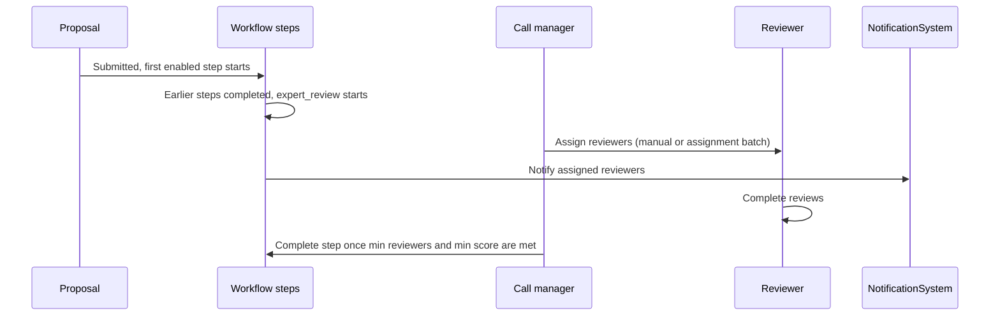

### Review Scoring System

Reviews include comprehensive scoring and feedback:

```python
class Review:
    # Overall assessment
    summary_score: int  # 1-5 (0 until rated)
    criteria_scores: dict  # criterion UUID -> 1-5, when the step has criteria
    summary_public_comment: str  # Visible to submitters
    summary_private_comment: str  # Internal use only

    # Field-specific feedback
    comment_project_title: str
    comment_project_summary: str
    comment_project_description: str
    comment_resource_requests: str
    comment_team: str

    # Confidentiality assessments
    comment_project_is_confidential: str
    comment_project_has_civilian_purpose: str
    comment_project_supporting_documentation: str
```

Every review is scored on the same 1-5 scale. Score gates (`min_score_threshold`),
score-spread run conditions and the averages across a call compare reviews of
different steps, so the scale is not configurable per step.

An assessment step can name **criteria** (for example *Excellence*, *Impact*,
*Quality of implementation*). The reviewer then rates each criterion 1-5, and
`summary_score` is derived from them: their average weighted by each
criterion's `weight` (1-100, relative to the step's other criteria), rounded
half up. A review cannot be submitted until every criterion is rated. Without
criteria the reviewer gives `summary_score` directly.

Once a reviewer has scored a step's criteria, or submitted a review in it, the
criteria and their weights are fixed: they can be reordered, not renamed,
removed, added or reweighted (the step reports this as `criteria_locked`).
Duplicating a call, exporting it and importing it carry the criteria and
their weights over.

The proposals and reviews CSV exports carry a column per criterion, and the
review e-mails to call managers list each criterion's score.

### Review Visibility Configuration

Calls can configure review transparency:

| Setting | Description | Impact |
|---------|-------------|--------|
| **`reviewer_identity_visible_to_submitters`** | Whether submitters see reviewer names | `False`: Shows "Reviewer 1", "Reviewer 2" |
| **`reviews_visible_to_submitters`** | Whether submitters see review details | `False`: Only final decision visible |

## Exports for Call Managers

Panel meetings, funding-body reporting and archiving work from a spreadsheet of
proposals plus one document per application. Three exports cover that.

### Proposal and review CSV

Two actions on the protected call stream a CSV:

| Endpoint | Rows |
|----------|------|
| `GET /api/proposal-protected-calls/<uuid>/export-proposals/` | One per proposal |
| `GET /api/proposal-protected-calls/<uuid>/export-reviews/` | One per review |

They take the same filters as the matching lists, so a filtered table exports
the rows it shows:

| Parameter | Proposals | Reviews | Limits the export to |
|-----------|:---------:|:-------:|----------------------|
| `round_uuid` | ✓ | ✓ | One round |
| `proposal_state` (repeatable) | ✓ | | Proposals in these states |
| `review_state` (repeatable) | | ✓ | Reviews in these states |
| `created_by_uuid` | ✓ | | One applicant |
| `reviewer_uuid` | | ✓ | One reviewer |
| `proposal_uuid` | | ✓ | One proposal |
| `proposal_name` | ✓ | ✓ | Proposals whose name contains the text |

The state and name filters are prefixed rather than bare `state` / `name`
because the call's own list filterset still runs when the endpoint resolves the
call, and reads a bare `state` or `name` as the *call's*.

An unknown state is refused with a 400 rather than ignored: a silently
unfiltered file is worse than an error.

The proposal export carries the proposal's identity, its created and submitted
dates, its applicant and organisation, its state and current workflow step, the
science sub-domain and the requested duration, **one column per requested
offering component** with the amount asked for, and the review counts, average
score and individual scores. Rejected reviews — declined, expired or dropped
for a conflict of interest — are left out of the counts, so "assigned" minus
"submitted" is the number still outstanding. The column set is derived from the call, not from
the proposals that matched the filters, so every row has the same shape and two
exports of one call line up. An offering gets columns once it is accepted, or
when proposals already asked for it before it was cancelled; a pending offering
cannot carry amounts yet and is left out.

The duration is what the proposal asks for, not what was granted: reading the
grant back costs a query per proposal.

`Proposal.submitted_at` is recorded when the proposal leaves draft. It is empty
for proposals submitted before that field existed: their submission was never
stored, and the only proxy — the first workflow step instance — was backfilled
by migration for the oldest of them, so it would read as the upgrade date. The
column is left empty rather than filled with a date that reads as fact.

The review export carries the proposal, the round, the proposal's step, the
reviewer, the state, the score, the public comment and the review deadline.

### Permissions and what is left out

Both exports require `UPDATE_CALL` on the call or its managing organisation —
staff, support (read-only) and call managers. Reviewers and panel members hold a
role on the call but not that permission, so they get a 403; an applicant cannot
see the protected call at all and gets a 404.

- `summary_private_comment` is **never** exported. The review API keeps it from
  call managers, and the export is open to them.
- Reviewer identity needs no such treatment: it is already visible to exactly
  the roles that may run an export (see `ProposalReviewSerializer.get_fields`),
  so no export can widen it.
- A step's `blind_review` does not apply. It hides evaluators' assessments from
  *each other*, not from the people running the call.
- Text that would start a spreadsheet formula (`=`, `+`, `-`, `@`, tab or
  carriage return) is written with a leading apostrophe. Proposal names,
  applicant profiles and review comments come from applicants and reviewers,
  and the file is opened by call managers. Numbers, negative ones included, are
  left as they are.

### Scale

The response is streamed row by row, and the queryset costs a fixed number of
queries regardless of how many proposals a call holds — the per-component
columns are resolved once from the call, and reviews and requested resources are
prefetched. A call with several thousand proposals starts sending bytes
immediately instead of waiting behind a proxy's read timeout.

### Per-proposal PDF

The application as the applicant filled it — fields, requested resources, team
and the *names* of its attachments — is rendered in the browser from the
proposal detail page (Homeport's `DownloadProposalPdfAction`). Rendering it
client-side keeps a PDF toolchain and its system packages out of the image for
the sake of one document, and the attachment files themselves stay behind the
media endpoint, which applies its own access rules.

## Call Dashboard Statistics

`GET /api/proposal-protected-calls/<uuid>/stats/` answers "where is each round?"
for one call. It returns a `call` block and a `rounds` list (one block per
round, with `uuid`, `slug`, `start_time` and `cutoff_time`). The round blocks
add up to the call block; a call with a single continuously open round has one
round block equal to the call block.

Each block holds:

| Field | Counts |
|-------|--------|
| `proposals` | Proposals by state: `draft`, `submitted`, `in_review`, `accepted` (awarded), `rejected` and `canceled` (not awarded), plus `total` |
| `admin_approved` | Proposals whose administrative check completed as `eligible` |
| `missing_admin_checks` | Proposals whose administrative check is active or expired |
| `reviews` | Reviews by state (`in_review`, `submitted`, `rejected`), plus `total` |
| `missing_reviews` | Proposals in expert review with fewer submitted reviews than the step's `min_reviewers`; 0 when the step sets no minimum |
| `overdue_reviews` | Reviews still in review past their deadline |
| `steps` | A list of `{step, label, count}`: proposals per current workflow step, over the call's enabled steps in catalogue order |

Steps disabled on the call do not appear in `steps`. Draft proposals have no
current step, so the step counts add up to the submitted proposals only.

The state and step counts can be opened in the proposal list: `round_uuid`,
`state` and `workflow_step` filter `GET /api/proposal-proposals/` to the same
set.

The endpoint takes the same permission as the call's exports — staff, support
(read-only), call managers and call organisers. Reviewers, panel members and
managers of other calls get a 403 or 404. All counts are grouped aggregates, so
the number of queries does not grow with the number of rounds or proposals.

## Integration with Waldur Marketplace

### Resource Provisioning Flow

Accepted proposals automatically trigger marketplace resource creation. What is
provisioned is the proposal's award (`AwardedResource`), not its requests:

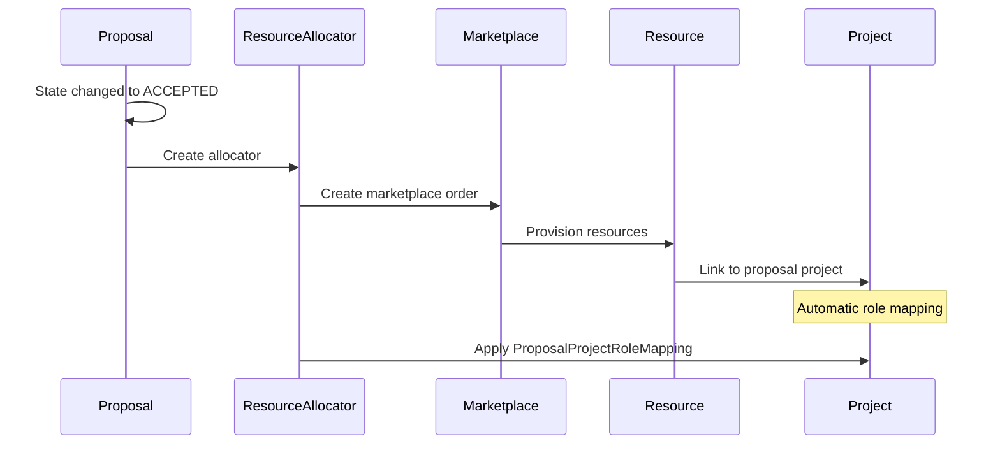

### Names of allocated projects and resources

The project is named by the call's `project_name_template`
(`proposal/allocation_names.py`). Without one it is
`<call reference code or slug> - <round start date> - <proposal name>`.
Placeholders: `{proposal_name}`, `{proposal_slug}`, `{call_prefix}`,
`{call_slug}`, `{call_name}`, `{round_start}` (YYYY-MM-DD), `{round_slug}`,
`{org_slug}`, `{year}`. The call serializer refuses any other placeholder,
positional fields, lookups, conversions and format specs, and holds the
template's literal text to `PROJECT_NAME_REGEX`. Only the template is
formatted: a brace in a proposal name stays a brace. The template is public
on the call, so the applicant's form previews the project name.

A resource is named by its offering's `plugin_options.resource_name_pattern`,
as an ordinary order is. A pattern without `{counter}` gets `-2`, `-3`, … on
further items of the award on the same offering. Without a pattern the
resource is `<project name> - <offering name>`, with `(n)` on repeated
offerings. Re-ordering an awarded item names it the same way.

### Awarded resources

`AwardedResource` is what the allocation decision grants, which may differ from
the request. `utils.prefill_awarded_resources` copies each `RequestedResource`
(offering, limits, attributes, description; not the plan) when the
`allocation_decision` step is activated, once per proposal:
`Proposal.awarded_resources_prefilled_at` records it, so an award the call
manager emptied is not refilled. Allocation prefills it too if the proposal
reached allocation without one, which provisions exactly what was requested.

| Field | Meaning |
| --- | --- |
| `requested_resource` | The request the item was copied from; empty for an item the call manager added |
| `requested_offering` | The call offering the item is awarded on |
| `plan` | A plan the call manager chose; empty follows the call offering's plan at allocation (`effective_plan`) |
| `limits`, `attributes`, `description` | What is ordered |
| `created_by` | Who added the item |
| `resource` | The marketplace resource allocation provisioned |

Endpoints: `GET`/`POST /api/proposal-proposals/{uuid}/awarded_resources/` and
`GET`/`PATCH`/`PUT`/`DELETE /api/proposal-proposals/{uuid}/awarded_resources/{obj_uuid}/`.

- **Editing** is for staff and users with the `CALL.MANAGER` role on the call,
  and only while the `allocation_decision` step is active. Otherwise the view
  answers `409`; a decision held for publication is not active, so it must be
  reopened first.
- **Validation.** `requested_offering_uuid` must be an offering of the call that
  its provider has accepted (required when adding). The plan must belong to that
  offering and not be archived; moving an item to another offering without
  naming a plan resets it to the call offering's plan. Limits must name an
  amount for an offering sold by amount (`names_an_amount`) and pass the
  component bounds and precision checks an order would. Prepaid duration
  attributes are validated as for a request.
- **Approval gate.** Completing `allocation_decision` with a positive outcome is
  refused while an awarded item on an accepted offering names no amount.
  Declining is never blocked.
- **Allocation** orders each awarded item on an accepted offering, in creation
  order, on its `effective_plan`, and links the resource to the item and to its
  request. A purchase order on the request is carried only while the item stays
  on the requested offering. The managers of an offering that was only awarded,
  never requested, see the proposal like those of a requested one.

**Who reads the award** (`user_can_view_awarded_resources`):

- staff and support, the call's managers and the managing organisation's call
  organisers, and managers of the offerings requested or awarded — at any time
  (an offering manager who is the applicant waits like an applicant);
- the applicant team (the proposal's team, members of the granted project)
  once the award is released (`awarded_resources_released`): the proposal is
  accepted, or the decision is an approval and the award response step has
  started or the allocation step is `applicant_visible` — never while the
  decision is held for the round's publication;
- nobody else; reviewers and panel members judge the proposal, not the award.

### What a call depends on in the marketplace

A call takes in an offering, has applicants request its components on one of
its plans, and orders the award on them later. The provider stays in charge of
the offering, so the marketplace asks before a change would pull any of that
from under a call (`marketplace.dependents`, answered by
`proposal.offering_impact`):

| Change | While a proposal still needs the offering | While only a call depends on it |
| --- | --- | --- |
| Archive, pause, send to draft or make unavailable the offering | Refused, except for staff | Allowed, with the calls named |
| Move it to another organisation without its team | Refused, except for staff | Allowed, with the calls named |
| Delete the offering or the call's plan | Refused for everyone | Refused for everyone |
| Archive the call's plan | Refused, except for staff | Allowed, with the calls named |
| Remove a component the call names, or stop billing it by limit | Refused for everyone | Refused for everyone |
| Lower a component's maximum below what the call allows or grants | Refused for everyone | Refused for everyone |

A proposal *needs* the offering while it is in evaluation with a request on
it, accepted with an item on it that allocation could not order, or has an
extension under way on it. `GET /api/marketplace-provider-offerings/{uuid}/dependents/?change=…`
returns the same answer before the change, for the confirmation dialog.

Renaming a component carries the new type into the call's limits, pools,
requests, awards, resource templates and extension requests. A component rule
keeps the limit period it had when the call took it in (`limit_period`), and
the pools count awards by it.

Allocation still checks each item as the order endpoint would: the offering
takes orders, its provider is not blocked, the plan is not archived and the
limits fit the components. An item that fails is not ordered: it records
`provision_error`, the call's managers are mailed, and once the provider has
fixed it a call manager orders it again with
`POST /api/proposal-proposals/{uuid}/provision_awarded_item/`. An item whose
order the provider refused hands its share back to the call's pools and is
left out of the proposal's extension and closing steps.

### The provider's side

The provider sees each call its offering is requested by, and acts on it:

- **The request.** Accepting shows what the provider commits to: the plan, the
  call's limits per proposal (`component_rules`) and its pools. Declining
  takes a reason, which the call's managers are told.
- **The team.** `team/` names the offering's managers, who do the team's part
  of each step, and everyone else with a role on the offering, whom a slot may
  be handed to. Only active users count: a deactivated sole manager leaves the
  call's managers standing in.
- **The open work.** `team_step_slots/` lists, per proposal, the team's open
  slots and who holds them; `team_slots/` does so across the provider's calls.
  `delegate_slots/` hands several slots to one person at once, and
  `set_default_delegate/` names who new slots go to as they open.
- **The orders.** An order an award places carries `award`: the call, the
  proposal and what was awarded against what was asked.

The offering's managers are mailed when a round of a call that took the
offering in opens (`offering_round_opened`), when the call changes its limits
or pools after they accepted (`call_offering_terms_changed`), and once a day
when their teams' slots opened or fell overdue (`offering_team_digest`).

### Role Mapping System

The `ProposalProjectRoleMapping` enables automatic role assignment. A new
call starts with these mappings, which its call manager can change:

| Proposal role | Project role |
| --- | --- |
| `PROPOSAL.MANAGER` | `PROJECT.MANAGER` |
| `PROPOSAL.ADMIN` | `PROJECT.ADMIN` |
| `PROPOSAL.MEMBER` | `PROJECT.MEMBER` |

A duplicated or imported call takes the source's mappings instead, when they
are copied.

When proposals are accepted:

1. System identifies users with proposal roles
2. Automatically assigns corresponding project roles
3. Users gain appropriate project permissions
4. Resources become accessible immediately

### Order Author

When a call grants resources it places a marketplace order per granted
resource. Those orders need a name on them. It is not a formality: for an
offering fulfilled by raising a helpdesk ticket, the order's `created_by` is
who the request is opened on behalf of and who the service desk replies to,
and it is who Waldur addresses its own order mail to. A robot has no email
address and cannot be either.

`Call.order_author` decides whose name they carry:

| Value | Orders are attributed to |
|-------|--------------------------|
| `applicant` (default) | The person who submitted the proposal |
| `project_manager` | The allocated project's manager |
| `call_manager` | A call manager on this call |
| `specific_user` | `Call.order_author_user` — e.g. a shared grants-office account |

Only someone holding a role on the call, on the organisation managing it, or on
that organisation's customer may be named. Whoever is named starts receiving
the call's order mail — project name, order description, limits — and, for a
helpdesk-backed offering, gets an account created for them on the service desk,
so the choice is kept to people already attached to the call.

```python
# Attribute every order this call places to the grants office
call.order_author = Call.OrderAuthor.SPECIFIC_USER
call.order_author_user = grants_office_user
call.save()
```

If the configured role is held by nobody, allocation falls back to the
applicant, and then to the system robot, rather than refusing to allocate.

#### Being named does not grant anything

The author is a name on the order, not an authorisation.

- **The spend was authorised by the call review.** Accepting the proposal is
  the consumer-side decision on the order: the granted project belongs to the
  call's managing organisation, so whoever accepted is deciding on that
  organisation's behalf, and they are recorded as the order's
  `consumer_reviewed_by`. An automatic acceptance records the system robot.
- **The order is carried out with system authority.** Provisioning replays the
  offering plugin's own API as a user, and the person named may hold no role on
  the granted project at all — a grants office typically does not. Allocated
  orders are therefore processed as the system robot, and the order is flagged
  `placed_automatically` to say so.
- **Reading a ticket in Waldur still needs a project role.**

!!! warning "Being the order's author does not grant access to its ticket in Waldur"
    Helpdesk tickets raised for these orders are scoped to the allocated
    project and its organization, and that scope is what decides who can read
    and answer them in the customer portal. An author with no role on the
    project still receives Waldur's ticket emails, but the
    `support/issue/<uuid>/` link in them will not open for them and they cannot
    comment in Waldur — only the helpdesk side works. This is worth weighing
    before pointing `call_manager` or `specific_user` at someone outside the
    project, such as a grants office.

#### What the ticket says about people

The creation ticket for an allocated order names the order's author as its
requester, and adds the applicant and a link to the proposal — they differ when
the call attributes its orders to a call manager or a named contact.

The proposal team is only listed when the offering tracks team changes
(`enable_issues_for_membership_changes`). Such an offering normally hears about
each member through a separate membership ticket, but those are raised only
once the project holds one of its resources, and allocation adds the team
before creating any. The creation ticket therefore carries a snapshot of the
project's active members with their roles; later changes raise membership
tickets as usual. Who the team is depends on the call's
[role mappings](#role-mapping-system): a call with none allocates an empty project.

#### When the author cannot receive a ticket

A helpdesk ticket needs an address. If the order's author has none — an SSO
account provisioned without an email claim, or an order left to the system
robot to place — the caller falls back through the project's manager,
administrator and member roles to the organization owner, taking the first
active user with an address. Only when nobody on the project can be reached
does the order fail, naming the project.

Because the name is on the order itself, this keeps working after allocation.
When the scheduled end-date sweep or a cost policy terminates a granted
resource months later, the termination order it places is attributed to the
author of the resource's own creation order — the contact the call named — so
its ticket reaches the same desk. The end-date sweep prefers a more specific
name where there is one: whoever requested the end date, on the resource and
then on the project. A candidate deactivated since is skipped. Only a creation
order placed on somebody's behalf — as allocation places them — passes its name
on: a resource somebody ordered themselves, an imported one, or one reconciled
from a backend orphan is left to the robot and the fallback above.

Such a termination order is flagged `placed_automatically` and carried out with
system authority, for the same reason an allocated order is: the contact named
on it need hold no role on the project.

## Realistic Usage Examples

### 1. Academic HPC Resource Allocation

**Use Case**: University research computing center allocating CPU hours

```python
# Call configuration
call = Call.objects.create(
    name="2024 Spring HPC Allocation",
    manager=university_hpc_center,
    state=CallStates.ACTIVE,
    reviewer_identity_visible_to_submitters=False,
    reviews_visible_to_submitters=True,
    fixed_duration_in_days=365  # 1-year allocations
)

# Round: scheduling fields; the lifecycle after the cut-off is not set here
round = Round.objects.create(
    call=call,
    start_time=datetime(2024, 1, 1),
    cutoff_time=datetime(2024, 2, 15),
)

# Evaluation policy: expert review with three reviewers and a 7.0 average
CallWorkflowStep.objects.filter(call=call, key="expert_review").update(
    is_enabled=True,
    min_reviewers=3,
    min_score_threshold=7.0,
)

# Resource template
template = CallResourceTemplate.objects.create(
    call=call,
    name="Standard Compute Allocation",
    requested_offering=hpc_offering,
    attributes={
        "cluster": "frontera",
        "partition": "normal",
        "max_walltime": "48:00:00"
    },
    limits={
        "cpu_hours": {"max": 1000000, "default": 50000},
        "storage_gb": {"max": 10000, "default": 1000}
    },
    is_required=True
)
```

**Workflow**:

1. Researchers submit proposals with resource requests
2. Expert reviewers evaluate scientific merit
3. Once three reviews averaging at least 7.0 are in, the call manager completes the review step and decides the allocation
4. HPC accounts created with specified limits
5. Usage tracked through marketplace billing

### 2. Cloud Infrastructure Grant Program

**Use Case**: Government agency providing cloud resources for research

```python
# Multi-round competitive program
call = Call.objects.create(
    name="National Cloud Research Initiative",
    manager=government_agency,
    reviewer_identity_visible_to_submitters=True,  # Transparent process
    reviews_visible_to_submitters=True
)

# Quarterly rounds; granted projects start on the round's allocation date
round_q1 = Round.objects.create(
    call=call,
    start_time=datetime(2024, 1, 1),
    cutoff_time=datetime(2024, 3, 15),
    allocation_date=datetime(2024, 4, 1)
)

CallWorkflowStep.objects.filter(call=call, key="panel_review").update(
    is_enabled=True
)
CallWorkflowStep.objects.filter(call=call, key="allocation_decision").update(
    allocation_time=AllocationTimes.FIXED_DATE
)

# Multiple resource options
compute_template = CallResourceTemplate.objects.create(
    call=call,
    name="Compute Instance Package",
    requested_offering=aws_compute_offering,
    limits={
        "vcpu": {"max": 100, "default": 8},
        "memory_gb": {"max": 500, "default": 32},
        "storage_gb": {"max": 1000, "default": 100}
    }
)

storage_template = CallResourceTemplate.objects.create(
    call=call,
    name="Data Storage Package",
    requested_offering=aws_storage_offering,
    limits={
        "storage_gb": {"max": 10000, "default": 1000},
        "backup_retention_days": {"max": 90, "default": 30}
    }
)
```

**Workflow**:

1. Research teams submit project proposals
2. Panel review with domain experts
3. Program managers manually select winning proposals
4. Resources allocated on fixed quarterly dates
5. Multi-year projects supported with renewal process

### 3. Startup Incubator Resource Program

**Use Case**: Accelerator providing development resources to startups

```python
# Rolling admission program
call = Call.objects.create(
    name="TechHub Startup Resources 2024",
    manager=tech_incubator,
    reviewer_identity_visible_to_submitters=False,
    reviews_visible_to_submitters=False  # Confidential evaluation
)

# One year-long round; each proposal is reviewed as soon as it is submitted
rolling_round = Round.objects.create(
    call=call,
    start_time=datetime(2024, 1, 1),
    cutoff_time=datetime(2024, 12, 31),
    review_duration_in_days=14  # Fast turnaround
)

CallWorkflowStep.objects.filter(call=call, key="expert_review").update(
    is_enabled=True, duration_in_days=14
)

# Startup development package
dev_template = CallResourceTemplate.objects.create(
    call=call,
    name="Startup Development Kit",
    requested_offering=development_platform_offering,
    attributes={
        "environment": "production_ready",
        "monitoring": "basic",
        "backup": "daily"
    },
    limits={
        "developer_seats": {"max": 10, "default": 3},
        "deployment_environments": {"max": 3, "default": 2},
        "monthly_compute_hours": {"max": 1000, "default": 200}
    },
    is_required=True
)
```

**Workflow**:

1. Startups apply continuously throughout year
2. Industry mentors review applications within 14 days
3. Incubator staff make acceptance decisions
4. Resources provisioned immediately upon acceptance
5. 6-month duration with renewal option

## Compliance Checklist Integration

### Optional Compliance Requirements

Calls can optionally include compliance checklists that proposals must complete before submission. This feature integrates with the marketplace checklist system to ensure regulatory or institutional compliance requirements are met.

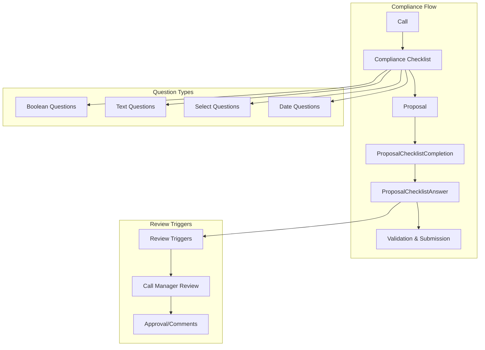

### Compliance Checklist Configuration

Call managers can assign compliance checklists when creating or editing calls:

```python
# Call with compliance requirements
call = Call.objects.create(
    name="Ethical Research Initiative 2024",
    manager=research_office,
    compliance_checklist=ethics_checklist,  # Optional compliance checklist
    state=CallStates.ACTIVE
)

# Compliance checklist example
ethics_checklist = Checklist.objects.create(
    name="Research Ethics Compliance",
    checklist_type=ChecklistTypes.PROPOSAL_COMPLIANCE,
    description="Mandatory ethics review for all research proposals"
)

# Compliance questions
Question.objects.create(
    checklist=ethics_checklist,
    description="Does your research involve human subjects?",
    question_type=QuestionTypes.BOOLEAN,
    required=True,
    review_answer_value=True,  # 'Yes' triggers call manager review
    operator="equals",
    order=1
)

Question.objects.create(
    checklist=ethics_checklist,
    description="Describe your data protection measures",
    question_type=QuestionTypes.TEXT_AREA,
    required=True,
    order=2
)
```

### Automatic Checklist Assignment

When proposals are created for calls with compliance checklists, completion tracking is automatically initialized:

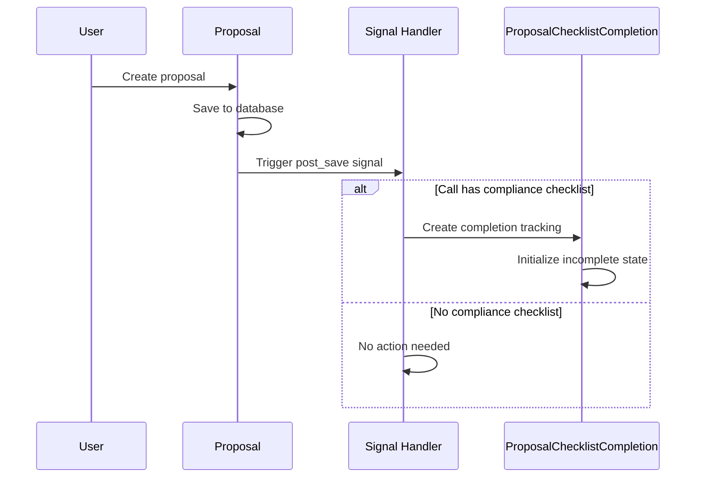

### Proposal Compliance Workflow

#### 1. Compliance Checklist Access

Proposal managers can access compliance checklists through dedicated endpoints:

```python
# API endpoint: GET /api/proposal-proposals/{uuid}/compliance_checklist/
{
    "checklist": {
        "uuid": "...",
        "name": "Research Ethics Compliance",
        "checklist_type": "proposal_compliance"
    },
    "completion": {
        "is_completed": false,
        "completion_percentage": 0.0,
        "requires_review": false,
        "unanswered_required_count": 3
    },
    "questions": [
        {
            "uuid": "...",
            "description": "Does your research involve human subjects?",
            "question_type": "boolean",
            "required": true,
            "existing_answer": null
        }
    ]
}
```

#### 2. Answer Submission

Proposal managers submit compliance answers:

```python
# API endpoint: POST /api/proposal-proposals/{uuid}/submit_compliance_answers/
[
    {
        "question_uuid": "...",
        "answer_data": true
    },
    {
        "question_uuid": "...",
        "answer_data": "We follow GDPR guidelines with encrypted storage..."
    }
]
```

#### 3. Automatic Review Triggering

Certain answers can trigger call manager review requirements:

```python
# Question configuration with review trigger
question = Question.objects.create(
    description="Does your research involve vulnerable populations?",
    question_type=QuestionTypes.BOOLEAN,
    review_answer_value=True,  # 'Yes' triggers review
    operator="equals"
)

# When answered 'True', completion is flagged for review
completion.requires_review = True
completion.save()
```

#### 4. Submission Validation

Proposals cannot be submitted while required questions of the call's
compliance checklist are unanswered. `Proposal.can_submit()` reports it, so the
form says what is missing before the applicant presses Submit, and the submit
action refuses it with the same message:

```python
def unanswered_compliance_questions(self) -> int:
    checklist = self.round.call.compliance_checklist
    if not checklist:
        return 0
    completion = self.get_checklist_completion_for(checklist)
    if completion is None:
        # Nothing answered yet: every required question is open.
        return checklist.questions.filter(required=True).count()
    return completion.get_unanswered_required_questions().count()
```

Optional questions never block submission, and answers that call for review
are reviewed after submission rather than holding it back.

### Call Manager Oversight

Call managers have comprehensive oversight capabilities for compliance management:

#### 1. Compliance Overview

View compliance status across all proposals in a call:

```python
# API endpoint: GET /api/proposal-protected-calls/{uuid}/compliance_overview/
{
    "checklist": {
        "name": "Research Ethics Compliance",
        "total_questions": 5,
        "required_questions": 3
    },
    "proposals": [
        {
            "uuid": "...",
            "name": "AI Ethics Study",
            "state": "draft",
            "compliance": {
                "is_completed": true,
                "requires_review": true,
                "completion_percentage": 100.0,
                "reviewed_by": null,
                "review_triggers": [
                    {
                        "question": "Does your research involve human subjects?",
                        "answer": true,
                        "trigger_value": true
                    }
                ]
            }
        }
    ]
}
```

#### 2. Detailed Answer Review

Access detailed compliance answers for specific proposals:

```python
# API endpoint: GET /api/proposal-protected-calls/{uuid}/proposals/{proposal_uuid}/compliance-answers/
{
    "proposal": {
        "uuid": "...",
        "name": "AI Ethics Study",
        "created_by": "Dr. Jane Smith"
    },
    "completion": {
        "is_completed": true,
        "requires_review": true,
        "completion_percentage": 100.0
    },
    "answers": [
        {
            "question_description": "Does your research involve human subjects?",
            "question_type": "boolean",
            "answer_data": true,
            "requires_review": true,
            "user_name": "Dr. Jane Smith"
        }
    ]
}
```

#### 3. Compliance Review and Approval

Call managers can review and approve compliance requirements:

```python
# API endpoint: POST /api/proposal-protected-calls/{uuid}/review_proposal_compliance/
{
    "proposal_uuid": "...",
    "review_notes": "Ethics approval obtained from IRB. Data protection measures adequate."
}

# Response includes review confirmation
{
    "detail": "Compliance review completed successfully",
    "reviewed_by": "Prof. Ethics Chair",
    "reviewed_at": "2024-08-01T10:30:00Z"
}
```

### Integration with Proposal Serializers

Proposal serializers automatically include compliance status information:

```python
class ProposalSerializer:
    def get_compliance_status(self, obj):
        """Get compliance checklist status."""
        if not obj.round.call.compliance_checklist:
            return None

        if not hasattr(obj, 'checklist_completion'):
            return {
                "error": "Compliance checklist not initialized",
                "has_checklist": True,
                "is_completed": False
            }

        completion = obj.checklist_completion
        return {
            "has_checklist": True,
            "is_completed": completion.is_completed,
            "requires_review": completion.requires_review,
            "completion_percentage": completion.get_completion_percentage(),
            "reviewed_by": completion.reviewed_by.full_name if completion.reviewed_by else None,
            "checklist_name": completion.checklist.name,
            "unanswered_required_count": completion.get_unanswered_required_questions().count()
        }

    def get_can_submit(self, obj):
        """Get whether proposal can be submitted."""
        can_submit, error = obj.can_submit()
        return {"can_submit": can_submit, "error": error}
```

### Real-World Use Cases

#### 1. University Ethics Compliance

```python
# Research ethics checklist for academic proposals
ethics_call = Call.objects.create(
    name="Faculty Research Grant Program",
    manager=university_research_office,
    compliance_checklist=research_ethics_checklist
)

# Sample ethics questions
questions = [
    {
        "description": "Does your research involve human subjects?",
        "type": "boolean",
        "triggers_review": True  # Requires IRB oversight
    },
    {
        "description": "Have you obtained IRB approval?",
        "type": "boolean",
        "required": True
    },
    {
        "description": "Upload IRB approval documentation",
        "type": "file_upload",
        "required_if": "previous_answer_yes"
    }
]
```

#### 2. Industry Safety Compliance

```python
# Industrial research safety checklist
safety_call = Call.objects.create(
    name="Industrial Innovation Grants",
    manager=industrial_research_center,
    compliance_checklist=safety_checklist
)

# Safety compliance questions
safety_questions = [
    {
        "description": "Does your research involve hazardous materials?",
        "type": "boolean",
        "triggers_review": True
    },
    {
        "description": "Select applicable safety categories",
        "type": "multi_select",
        "options": ["Chemical", "Biological", "Radiological", "Physical"]
    },
    {
        "description": "Describe safety protocols and risk mitigation",
        "type": "text_area",
        "required": True
    }
]
```

#### 3. Government Security Clearance

```python
# Security clearance for government research
security_call = Call.objects.create(
    name="Defense Research Initiative",
    manager=defense_agency,
    compliance_checklist=security_clearance_checklist
)

# Security questions with automatic review triggers
security_questions = [
    {
        "description": "Does your research involve classified information?",
        "type": "boolean",
        "triggers_review": True  # Automatic security review
    },
    {
        "description": "List team members requiring security clearance",
        "type": "text_area",
        "required_if": "classified_research"
    },
    {
        "description": "Facility security clearance level",
        "type": "single_select",
        "options": ["Unclassified", "Confidential", "Secret", "Top Secret"]
    }
]
```

### Benefits of Compliance Integration

1. **Automated Compliance Tracking**: Ensures all proposals meet regulatory requirements before submission
2. **Flexible Question Types**: Supports various question formats (boolean, text, select, date) for comprehensive compliance assessment
3. **Review Triggering**: Automatically flags proposals requiring additional oversight based on specific answers
4. **Call Manager Oversight**: Provides administrators with comprehensive compliance monitoring and approval capabilities
5. **Audit Trail**: Maintains complete records of compliance answers and review decisions
6. **Integration with Submission**: Prevents non-compliant proposals from being submitted to review process

The compliance checklist system seamlessly integrates with the existing proposal workflow while providing the flexibility needed for various regulatory and institutional requirements.

## Advanced Features

### Project Integration

Accepted proposals create Waldur projects with automatic configuration:

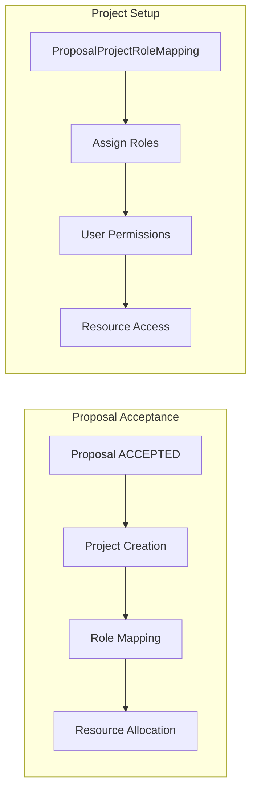

### Notification System

Comprehensive notification system keeps stakeholders informed:

| Event | Recipients | Content |
|-------|-----------|---------|
| **Proposal Submitted** | Call managers, reviewers | New proposal requiring review |
| **Review Assigned** | Individual reviewers | Review assignment with deadline |
| **Review Completed** | Call managers | Review submitted notification |
| **Proposal Accepted** | Proposal team, call managers | Acceptance with resource details |
| **Proposal Rejected** | Proposal team | Rejection with feedback |
| **Round Closing** | All stakeholders | Deadline reminder |

### Audit Trail

Complete audit logging for compliance and transparency:

```python
# All state changes logged
proposal.tracker.has_changed('state')  # Tracks state transitions
review.tracker.has_changed('summary_score')  # Tracks review updates

# Event logging integration
event_logger.proposal.info(
    'Proposal {proposal_name} has been accepted.',
    event_type=EventType.PROPOSAL_ACCEPTED,
    event_context={'proposal': proposal}
)
```

## Error Handling and Data Integrity

### Validation Framework

Comprehensive validation ensures data consistency:

```python
class ProposalProjectRoleMapping:
    def clean(self):
        # Ensure project role is actually for projects
        if (self.project_role and
            self.project_role.content_type.model_class().__name__ != "Project"):
            raise ValidationError("Role should belong to the project type.")

        # Ensure proposal role is for proposals
        if self.proposal_role.content_type.model_class().__name__ != "Proposal":
            raise ValidationError("Role should belong to the proposal type.")
```

### State Transition Guards

Prevent invalid state changes:

```python
def submit_proposal(proposal):
    if proposal.state != ProposalStates.DRAFT:
        raise IncorrectStateException("Can only submit draft proposals")

    if not proposal.requestedresource_set.exists():
        raise ValidationError("Proposal must include resource requests")

    proposal.state = ProposalStates.SUBMITTED
    proposal.save()
```

### Resource Cleanup

Automatic cleanup for canceled or rejected proposals:

```python
def cleanup_proposal_resources(proposal):
    if proposal.state in [ProposalStates.CANCELED, ProposalStates.REJECTED]:
        # Clean up any provisional resources
        proposal.requestedresource_set.filter(
            resource__state=ResourceStates.CREATING
        ).update(resource__state=ResourceStates.TERMINATED)
```

## Performance Considerations

### Query Optimization

- Eager loading for nested relationships
- Database indexes on frequently queried fields
- Efficient permission filtering

### Scalability Patterns

- Asynchronous review assignment for large calls
- Batch processing for resource allocation
- Cached statistics for dashboard views

### Monitoring Integration

- Review progress tracking
- Resource utilization monitoring

## Related Documentation

- [Call Eligibility and Applicant Attributes](./proposals-eligibility.md) - AAI-based eligibility restrictions and GDPR-compliant attribute exposure
- [Conflict of Interest Detection](./proposals-coi.md) - COI management and detection workflows
- [Reviewer Matching](./proposals-matching.md) - Affinity scoring, reviewer suggestions and assignment
- [User Profile Attributes](../user-profile-attributes.md) - User attribute reference for AAI integration
