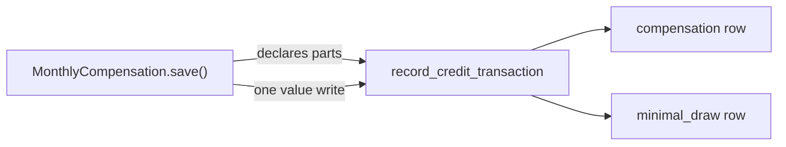

# Credit ledger

`CreditTransaction` is an append-only record of every change to a credit
balance — `CustomerCredit` for an organization, `ProjectCredit` for a project
allocation. It answers two questions that nothing else in the system can:
what an organization credit is *made of* — granted, paid and earned money,
kept as [credit lots](#credit-lots) — and where the credit *went*.

## Why the invoice items are not enough

A month of compensation moves a balance twice, in one write:

- against real usage, which leaves a negative `InvoiceItem`;
- to top that draw up to the minimal-consumption floor, which leaves nothing at
  all — the value simply drops.

So anything reconstructing history from invoice items sees only the first
movement. "Used", "Lost", "Last month drew" and the consumption chart all read
about half the money, and a figure derived as
`lost = max(0, |compensation| − incurred)` is structurally zero, because a
compensation never exceeds the cost it offsets.

The ledger records both movements, which makes the balance reconcile:

```text
granted = used + lost + remaining
```

where `remaining` is the credit's current `value`.

## Transaction types

| Type | Meaning |
|------|---------|
| `staff_grant` | An untyped write — staff UI, REST, shell. The conservative default. Opens a granted lot. |
| `top_up` | A customer prepayment recorded by staff. Opens a paid lot; a negative one reverses a prepayment and draws paid lots. |
| `reclassification` | A pair of rows that cancel out, moving granted credit to paid. |
| `compensation` | Credit given up against real usage. |
| `historical_compensation` | A project credit paying an earlier, closed invoice that no credit covered (`invoices/settlement.py`). Never rolled back. |
| `minimal_draw` | Credit given up to reach the minimal-consumption floor: the "Lost" figure, spent without buying anything. |
| `affiliate_fee` | A fee earned by referring another organization. |
| `transfer_in` / `transfer_out` | Credit moved between organizations. |
| `payout` | Earned credit paid out of the platform. |
| `expiry` | Granted credit removed because the credit's end date passed. Paid and earned credit do not expire. |
| `rollback` | A month's compensation reversed, before it is re-applied. |
| `adjustment` | A correction that is not withdrawable. |
| `withdrawable_adjustment` | A staff correction of the withdrawable part. |

## How a row is written

A `post_save` handler on both credit models computes the delta from the
model's `FieldTracker` and writes a row, and for an organization credit moves
its lots by that row. Ledger writes are never suppressed — unlike the audit
events, which flows can silence to avoid duplicates — because the lots and the
drawdown history are derived from them.

The *semantic type* comes from the innermost
`ledger.credit_transaction_type(...)` block. A flow that does not declare one
has its write recorded as a staff grant rather than skipped, so an untyped path
degrades to a conservative default instead of leaving a gap.

### One write, two kinds of movement

Compensation applies both the usage draw and the floor draw in a single `value`
write, so a single type cannot describe it. Saving twice was rejected: it fires
the policy `post_save` receivers twice and briefly exposes an intermediate
balance to policy evaluation.

Instead the writer *declares the breakdown* of the delta it is about to apply,
with `ledger.credit_transaction_parts(...)`, and the handler emits one row per
part:



Two properties make this safe to rely on:

- **The split is measured, not inferred.** The compensation flow records what
  each balance gives up at the point of each subtraction, rather than deriving
  it from the invoice items afterwards. The last partial compensation of an
  exhausted credit is written net of tax, so the item and the balance movement
  genuinely differ there.
- **A breakdown that does not add up is refused.** If the parts do not sum to
  the delta, the handler logs a warning and records the movement as a single
  row instead, so the ledger never states a split it cannot back. The row still
  takes its type from the enclosing `credit_transaction_type` block — declare
  both, or a refusal degrades to an untyped staff grant.

## Credit lots

An organization credit is one balance, but the money in it is not
interchangeable: an affiliate earns a fee on invoices paid from a prepayment
but not from a grant, and only earnings may leave the platform. So
`CustomerCredit` is split into `CreditLot` rows of three kinds, and its `value`
is always the sum of what they have left. Everything that reads the balance —
cost policies, project allocations, openportal — keeps reading that one number.

| Kind | Opened by | Meaning |
|------|-----------|---------|
| `granted` | `staff_grant`, and any untyped write | A discount. Expires with the credit's `end_date`. |
| `paid` | `top_up`, `reclassification` | The customer's money. Counts towards the affiliate fee base when spent; never expires. |
| `earned` | `affiliate_fee`, `transfer_in`, `withdrawable_adjustment` | The organization's money. Its remainder is the withdrawable balance; never expires. |

`lots.apply_transaction` turns each organization ledger row into lot movements,
and records each one as a `CreditLotDraw` (lot, row, signed amount):

- **An inflow opens a lot** of the kind its type maps to.
- **An outflow draws lots** granted first, then paid, then earned, oldest
  first within a kind. Payouts, transfers out and negative withdrawable
  adjustments draw earned lots first, and a negative top-up paid lots first;
  their endpoints refuse amounts the kind does not cover, so other lots only
  ever cover a drift. Expiry is sized to the granted remainder, so it
  takes granted lots only.
- **A roll-back or a correction that gives credit back** (`rollback`, positive
  `adjustment`) returns it to the lots that earlier movements for the same
  invoice took it from, last drawn first. Anything beyond what they took opens
  a granted lot. Payments of earlier invoices (`historical_compensation`)
  are never rolled back, so nothing is returned to the lots they drew.

Project allocations are caps on the organization balance rather than money of
their own, so they have no lots, and an allocation pays no more of a month's
usage than the organization credit has left. When the organization credit runs
out on an allocation's item, that last draw is compensated net of tax, as
outside an allocation.

An allocation keeps its own `end_date`, and expiry still sets it to 0. A
project whose allocation has expired draws nothing more, even while the
organization keeps paid or earned credit past the organization credit's end
date. For the project to draw that credit, an owner gives the allocation a
new value and end date, or removes it. An allocation marked
`mark_unused_credit_as_spent_on_project_termination` forfeits what it has left
when its project is removed, but no more than the granted balance: it is an
`adjustment` that takes granted lots only, so paid and earned credit stay with
the organization.

Staff record a prepayment with `POST /api/customer-credits/{uuid}/top_up/`
(amount, comment, optional payment and external references), reverse one
with a negative amount, and move granted credit that was really a prepayment
with `POST /api/customer-credits/{uuid}/reclassify/`. They emit
`credit_topped_up` and `credit_reclassified_as_paid` events carrying the
comment and the acting user.
A top-up sent with an `external_reference`, such as an ERP payment ID, is safe
to retry: the reference is unique per organization credit, a repeat with the
same amount returns the credit unchanged, and one with another amount is
refused. Only the reference and the amount are compared: a repeat's `comment`
and `payment_reference` are ignored, and the ledger row keeps the first call's
text. A reversal is a movement of its own and needs its own reference: one
sent with the reference of the top-up it reverses is refused as another
amount. The `payment_reference` is only kept in the comment and is never
checked for repeats. The ledger row records how the top-up arrived in
`channel`: `api` with a reference, `manual` without. `gateway` is reserved for
payment gateways, which will call `invoices.topups.top_up` directly (#1152).
Other movements read `manual`.
A staff edit of `value` may lower it by no more than the granted balance:
paid and earned credit leave only through their typed actions. These staff
actions — and creating, editing or deleting a credit, the compensation actions,
`pay_earlier_invoices` and affiliate links — need the staff scope on a personal
access token. A token bound to organizations sees only their credits.

The minimal-consumption floor spends granted credit that would otherwise go
unused, so it takes only the granted credit left after the month's usage:
paid and earned credit do not expire, and a floor would drain them. The linear
logic accordingly spreads the granted balance, not the whole value, until
the end date. Once the credit's end date has passed, no minimal consumption is
charged at all. Clearing a month's compensations gives back what the month's
`compensation` and `minimal_draw` rows took, for the organization credit and
each allocation, even in a month whose only draw was the floor.
`GET /api/customer-credits/` reports `paid_balance`, `granted_balance` and
`withdrawable_balance` (the earned remainder). When the end date takes only
part of the credit, the event is `granted_credit_expired`;
`set_to_zero_overdue_credit` is kept for a credit that expiry empties.

Writes that bypass the `post_save` handler — queryset `update()` calls, as
`import_structure` makes — leave the lots behind the value. `lots.resplit`
rebuilds them by replaying the credit's ledger oldest row first, so what was
spent stays spent and roll-backs find the draws they return; whatever the
ledger does not explain is settled last, a surplus as granted credit and a
deficit drawn in the usual order. `import_structure` rebuilds only the credits
it wrote. A rebuild applies the current rules to the whole ledger, including the
rows from before lots: earnings spent before then count as spent, so rebuilding
a credit the migration split can lower its withdrawable balance. The migration that introduced lots split every existing credit into
an earned lot of the old withdrawable balance and a granted lot of the
rest, so balances, withdrawable balances and affiliate fees were unchanged by
it.

## Billing period

`billing_period` is the first day of the month a movement *belongs to*, which is
not the month it was recorded in. It is a real column rather than the
`reference` generic foreign key, because dashboards group drawdown by month in
SQL and a generic foreign key cannot be grouped on.

Movements that reverse or re-state a month carry that month, not the day they
ran. Applying compensations is a roll-back followed by a re-application, and
staff can run it against a pending invoice repeatedly; an undated roll-back
would leave every superseded run standing in its month, and the month would
report its drawdown once per run.

Grants, expiry and transfers belong to no month and leave it empty.

## Attribution outlives the allocation

`ProjectCredit` is deleted outright when its project is removed, so the row
cannot rely on the foreign key alone. `project_credit` is `SET_NULL`, and the
project's uuid and name are denormalised onto the row — a ledger that loses its
attribution on a delete is not a ledger.

## Reading the ledger

`GET /api/credit-transactions/` is read-only and scoped by role: staff see
every row, an organization owner sees their organization's rows on either
balance, and project roles see their own project's drawdown.

| Filter | Selects |
|--------|---------|
| `customer_uuid` | Rows on either balance belonging to that organization |
| `credit_uuid` | Rows on one organization credit |
| `project_credit_uuid` | Rows on one project allocation |
| `project_uuid` | A project's rows, including those whose allocation is gone |
| `transaction_type` | One type |
| `channel` | One or more channels: `api`, `gateway`, or `manual` (every row that is not an `api` or `gateway` top-up) |
| `external_reference` | The top-up with that sender reference |
| `billing_period` | One month |
| `billing_period_after` / `billing_period_before` | A range of months |

Each row of an organization credit also reports `granted_change`,
`paid_change` and `earned_change`: how it moved each kind of credit, as the
lots it opened less what it drew from lots. A compensation can draw on
several kinds at once, and a reclassification is a granted draw paired with
a paid inflow. They are null on a project allocation's rows, which have no
lots, and zero on rows recorded before lots existed.

Ordering is available on `created` and `billing_period` via `o`.

Note that `project_uuid` filters the denormalised column rather than the
allocation, which is what keeps a deleted project's history queryable.

## Append-only

Rows are never edited or deleted: the credit lots are derived from the
ledger, and corrections are new rows.

The single exception is
[backfilling history that predates the ledger](admin/credit-ledger-backfill.md),
where `--force` deletes and rewrites the rows that command itself wrote. It
touches nothing else, and reconstructed rows are labelled as such.
