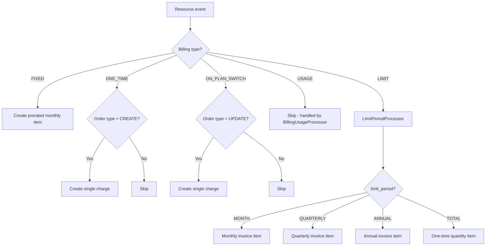
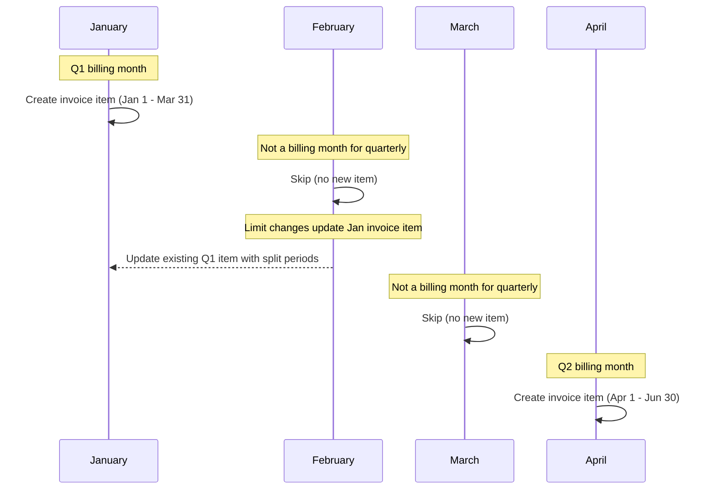
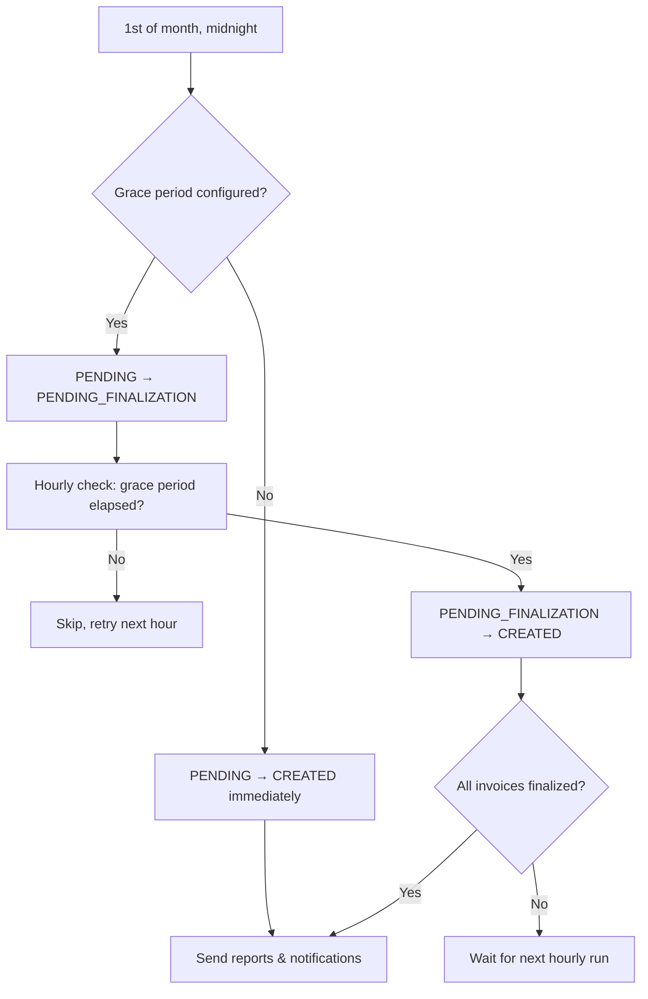
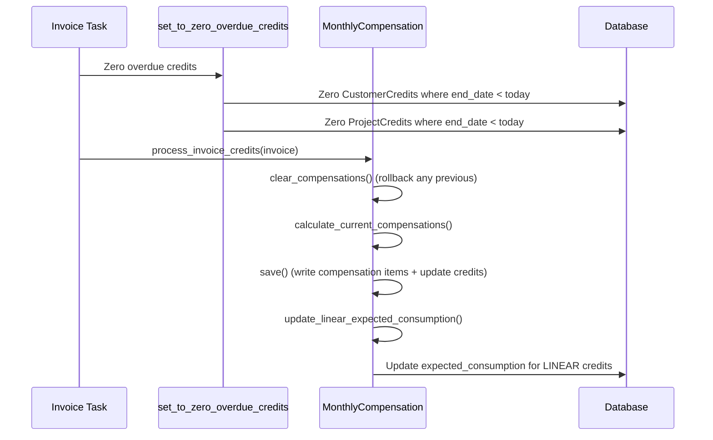
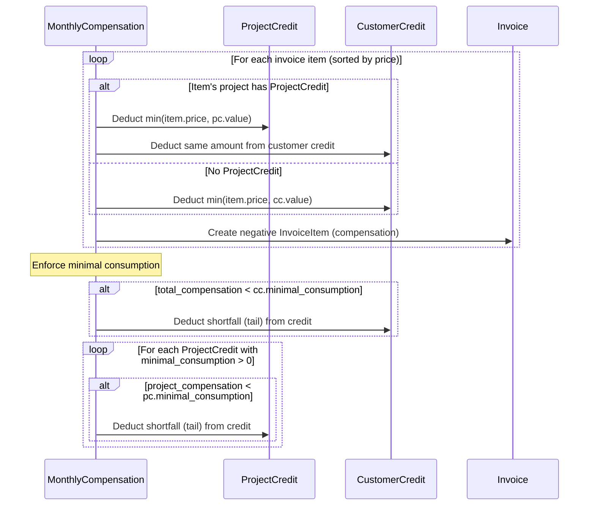
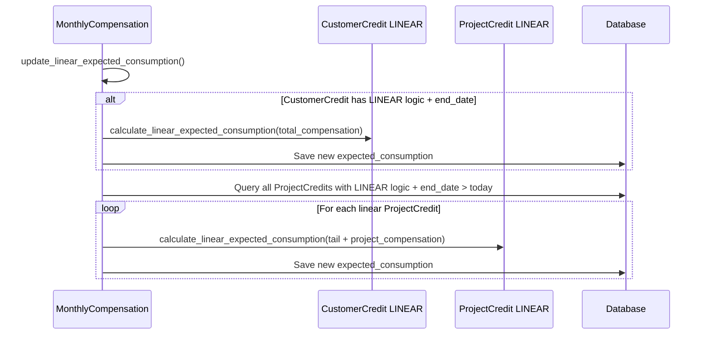
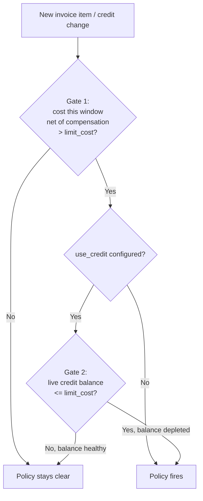
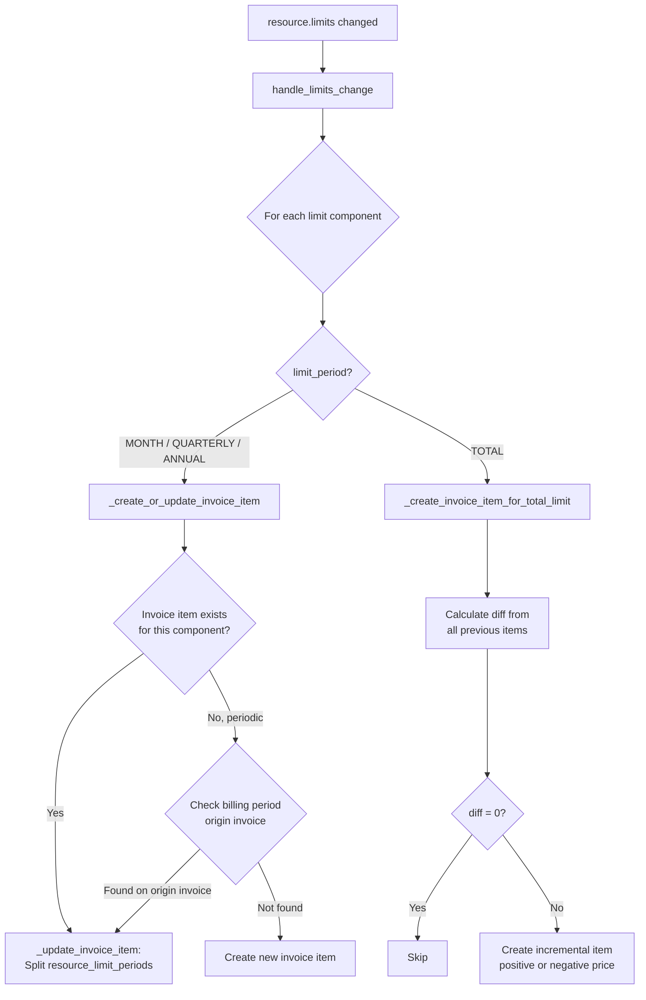

# Billing and Invoicing

## Overview

Waldur's billing system creates invoice items for marketplace resources based on their offering component's billing type. The central orchestrator is `MarketplaceBillingService` (`src/waldur_mastermind/marketplace/billing.py`), which dispatches to specialized processors depending on the billing type.

## Billing Types

Defined in `BillingTypes` (`src/waldur_mastermind/marketplace/enums.py`):

| Type | Value | Trigger | Recurrence | Handler |
|------|-------|---------|------------|---------|
| FIXED | `"fixed"` | Resource activation | Monthly (prorated) | `MarketplaceBillingService` |
| USAGE | `"usage"` | Usage report submission | Per report | `BillingUsageProcessor` |
| ONE_TIME | `"one"` | Resource creation | Once | `MarketplaceBillingService` |
| ON_PLAN_SWITCH | `"few"` | Plan change | Once per switch | `MarketplaceBillingService` |
| LIMIT | `"limit"` | Resource creation / limit change | Varies by `limit_period` | `LimitPeriodProcessor` |

## Billing Type Dispatch



## Limit Periods

For components with `billing_type=LIMIT`, the `limit_period` field on `OfferingComponent` controls when and how invoice items are created.

Defined in `LimitPeriods` (`src/waldur_mastermind/marketplace/enums.py`):

| Period | Value | Invoice creation | Billing window | Unit |
|--------|-------|-----------------|----------------|------|
| MONTH | `"month"` | Every month | 1st to end of month | Plan unit |
| QUARTERLY | `"quarterly"` | Months 1, 4, 7, 10 only | Quarter start to quarter end (e.g., Jan 1 - Mar 31) | Plan unit |
| ANNUAL | `"annual"` | Resource's creation anniversary month | 12 months from delivery date | Plan unit |
| TOTAL | `"total"` | Once on creation; incremental on changes | Full resource lifetime | QUANTITY |

### Quarterly Billing Timeline



## Invoice Lifecycle

### Invoice States

| State | Description |
|-------|-------------|
| PENDING | Active invoice for current billing period. Items can be added/modified. |
| PENDING_FINALIZATION | Transitional state used when a grace period is configured. Items can still be added/modified. |
| CREATED | Finalized invoice. Items are frozen. |
| PAID | Invoice has been paid. |
| CANCELED | Invoice has been canceled. |

Both PENDING and PENDING_FINALIZATION are considered **mutable states** — invoice items can be added or updated while the invoice is in either state.

### Monthly Invoice Creation

The `create_monthly_invoices` task (`src/waldur_mastermind/invoices/tasks.py`) runs at midnight on the 1st of each month:

1. Previous month PENDING invoices are finalized (see Finalization below)
2. For each customer, `MarketplaceBillingService.get_or_create_invoice` is called
3. If the invoice is newly created, all active billable resources are processed via `_process_resource`

When a resource is activated mid-month, `_register` calls `get_or_create_invoice`. If the invoice already exists, it adds items for just that resource with prorated start/end dates.

### Invoice Finalization

Finalization transitions invoices from mutable to immutable (CREATED) state. The behavior depends on the `INVOICE_FINALIZATION_GRACE_PERIOD_HOURS` setting:

**Without grace period** (default, `grace_hours = 0`):

1. On the 1st at midnight, `create_monthly_invoices` finalizes previous month invoices immediately
2. Overdue credits are zeroed, compensations are applied, invoices transition PENDING → CREATED
3. Reports and notifications are sent

**With grace period** (e.g., `grace_hours = 24`):

1. On the 1st at midnight, `create_monthly_invoices` transitions previous month invoices to PENDING_FINALIZATION
2. The `finalize_previous_invoices` task runs hourly on the 1st–3rd of each month
3. Once the configured grace period has elapsed (measured from midnight on the 1st), it finalizes: PENDING_FINALIZATION → CREATED
4. Reports and notifications are sent only after all invoices are finalized

The grace period allows late usage data (e.g., from external billing systems) to be captured before invoices are frozen.



### Credits and Compensations

Waldur supports a two-level credit system: **CustomerCredit** (organization-wide) and **ProjectCredit** (per-project allocation). Both inherit from `BaseCredit` (`src/waldur_mastermind/invoices/models.py`).

#### Credit Model

| Field | Type | Description |
|-------|------|-------------|
| `value` | Decimal | Remaining credit balance |
| `end_date` | Date (nullable) | Expiry date (must be 1st of month) |
| `expected_consumption` | Decimal | Target monthly spend |
| `minimal_consumption_logic` | `FIXED` / `LINEAR` | How expected consumption is managed |
| `grace_coefficient` | Decimal (0-100) | Percentage discount on minimal consumption |
| `apply_as_minimal_consumption` | Boolean | Whether to enforce minimal consumption |

**ProjectCredit** is a sub-allocation of the customer credit. The sum of all project credit values cannot exceed the customer credit value.

Every change to either balance is recorded in the [credit ledger](../credit-ledger.md), which is what makes the drawdown below observable after the fact: the minimal-consumption tail writes no invoice item, so the ledger is the only place it is visible.

#### Invoice Finalization Flow

During invoice finalization, credits are processed via `process_invoice_credits()`:



#### Compensation Calculation

`MonthlyCompensation.calculate_current_compensations()` processes invoice items sorted by price (ascending):

1. For each item, check if the item's project has a **ProjectCredit**
2. If yes: deduct from the project credit first, then from the customer credit
3. If no: deduct directly from the customer credit
4. Create a negative `InvoiceItem` (compensation) for each deduction
5. After all items, enforce **minimal consumption** for both customer and project credits



Both deductions against a balance — what usage consumed and what the floor took
— land in a single `value` write. The flow declares the breakdown so that the
ledger can record them as separate `compensation` and `minimal_draw` rows; see
[Credit ledger](../credit-ledger.md).

#### Minimal Consumption

Minimal consumption ensures a minimum credit spend per month, preventing credits from being hoarded.

**Formula**:

```text
If end_date is this month:
    minimal_consumption = expected_consumption

Otherwise:
    minimal_consumption = (100 - grace_coefficient) / 100 * expected_consumption
```

If `apply_as_minimal_consumption` is `False`, minimal consumption is 0 (disabled).

#### Minimal Consumption Logic: FIXED vs LINEAR

**FIXED** (default): `expected_consumption` is set manually and stays constant.

**LINEAR**: `expected_consumption` is recalculated each month to ensure the credit is consumed by `end_date`. The formula is:

```text
new_expected = max(0, old_expected - total_compensation) * (1 - time_left_factor)
             + remaining_value * time_left_factor

where:
    time_left_factor = min(1, days_in_current_month / days_until_end_date)
```

This creates a sliding target: as the end date approaches, `time_left_factor` increases toward 1.0, pushing `expected_consumption` toward the full remaining credit value. This guarantees the credit is consumed by expiry.



#### Overdue Credit Zeroing

`set_to_zero_overdue_credits()` runs during invoice finalization and zeros both customer and project credits whose `end_date` has passed. Zeroing a project credit does **not** affect the customer credit balance.

When a grace period is used, the effective date for zeroing credits is always the 1st of the current month (not the actual finalization date). This ensures credits with `end_date` on the 1st are still applied to the previous month's invoice before being zeroed.

#### Credit Events

| Event | Trigger |
|-------|---------|
| `reduction_of_customer_credit` | Compensation item created |
| `reduction_of_project_credit` | Compensation item created for project |
| `reduction_of_customer_credit_due_to_minimal_consumption` | Customer tail deducted |
| `reduction_of_project_credit_due_to_minimal_consumption` | Project tail deducted |
| `reduction_of_customer_expected_consumption` | LINEAR recalculation (customer) |
| `reduction_of_project_expected_consumption` | LINEAR recalculation (project) |
| `set_to_zero_overdue_credit` | Expired credit zeroed |
| `roll_back_customer_credit` | Compensation cleared |
| `roll_back_project_credit` | Compensation cleared |

#### Cost Policies and Compensation

`waldur_mastermind.policy`'s `ProjectEstimatedCostPolicy` and `CustomerEstimatedCostPolicy` (`src/waldur_mastermind/policy/models.py`) net cost against credit in two independent steps inside `evaluate()` (`EstimatedCostPolicyMixin._credit_gates`), not one combined comparison. `is_triggered()` is `evaluate().triggered`; see [Decision record](#decision-record) for what else an evaluation reports.



**Gate 1** sums every `InvoiceItem` for the project/customer across the policy's rolling window (1/3/12 months, or all months for Total) via `EstimatedCostPolicyMixin._evaluated_cost` -- cost items and compensation items together, unfiltered by type, since a compensation item is just a negative-priced row on the same invoice. For a month whose invoice has already been finalized -- including one `rebill_historical_usage` has just corrected -- this sum is entirely real, persisted data. There's no simulation involved in reading it. It opens when that net cost is strictly greater than `limit_cost`.

On top of that sum, the evaluation additionally subtracts the credit the customer's *current, still-mutable* invoice will still draw (`_pending_compensation`). That comes from a `MonthlyCompensation(customer, restore_written=True)` simulation, re-run in memory on every evaluation and never saved (it refuses to `save()`). It has no bearing on any past month already reflected in the sum above.

**Gate 2** compares the **live** credit balance, not the stored `CustomerCredit.value` / `ProjectCredit.value`. The stored value only falls when the month's compensations are written at the month-end run, so mid-month it still contains everything this month's usage has already consumed; comparing it held every credit-funded policy back until the 1st. The live balance comes from the same simulation (`_live_credit_balance()`):

```text
live balance = stored value + restored − usage draw
```

- `restored` is what this month's applies already took (staff can apply compensations mid-month), read from the credit ledger: this billing period's `compensation`, `minimal_draw` and `rollback` rows, per organization credit and project allocation. `restore_written=True` adds it back to the simulation's in-memory credits first, so the month is simulated from its opening balance; re-simulating from a stored value an apply had already lowered would cap the draw there. The ledger is used, not the invoice items, because the minimal-consumption floor writes no item and is only partly taken when the credit left is smaller than it.
- `usage draw` is what the simulation records usage taking off the balance this month (`customer_usage_draw`, `get_project_usage_draw(project)`). Usage only: the minimal-consumption floor is forfeited at month end whatever the usage, so counting it would make a credit with an expected consumption read as spent on day 1.

A project with a `ProjectCredit` is judged on the lower of its live allocation and the organization's live balance, since the allocation can only be drawn while the organization credit funding it lasts (`ProjectCredit.spendable_value`); without one, on the organization's live balance. Gate 2 is only consulted once gate 1 is already open (`use_credit=False` policies skip it and compare gross cost instead). `get_eta_days()` projects from the same live balance, so the ETA agrees with `is_triggered()`.

The two gates read genuinely different facts -- gate 1 is a net invoiced position over a window, gate 2 is the remaining reserve -- so they can disagree for ordinary reasons. This window's net cost can be high because credit only partially covered it, correctly, if the pool was scarce at finalization time; or because a later correction's compensation update didn't fully rebalance against a sibling sharing the same credit, since `rebill_historical_usage`'s own correction is a simplified 1:1 update to the one resource being fixed, not a full cheapest-first re-run across every resource sharing that credit (see its `sibling_compensations` warning). Either way, the real balance behind it can still have plenty of untouched headroom for other resources or future spend. The policy fires only when both independently say the account is over budget.

With period Total and earlier uncovered cost already above `limit_cost`, gate 1 stays open permanently and gate 2 alone decides: `limit_cost` then works as a minimum remaining credit.

Verified example, from `scripts/simulate_rebill_historical_usage.py`'s scenario B: a resource billed 500 node-hours (1,425), fully compensated at finalization time from a 3,000 project credit (1,575 left over). A correction raises the reported usage to 3,000 node-hours (8,550) -- the credit correction aborts (7,125 needed, only 1,575 available), so the compensation item stays at its old value. Gate 1 for that project: 8,550 − 1,425 = 7,125, against a `limit_cost` of 3,000 -- opens. Gate 2: the live project credit balance -- with no usage in the current month, the stored 1,575 -- is also below 3,000 -- opens too.

##### Decision record

`evaluate()` returns a `PolicyDecision` (`src/waldur_mastermind/policy/structures.py`) naming the check that decided the evaluation and the figures it used:

| Field | Meaning |
|-------|---------|
| `triggered` | Whether the policy fires |
| `gate` | Which check decided (see below) |
| `evaluated_cost` | The cost compared against `limit_cost`, net of `credit_deduction` |
| `credit_deduction` | The credit the current month will still draw that is not yet written as compensation items (`_pending_compensation`); compensation already written is part of the window's invoice total |
| `limit_cost`, `period`, `use_credit` | The policy settings it was judged on |
| `credit_value_compared` | The live balance gate 2 compared (after the new resource's draw, in a creation check), or empty when gate 2 did not run |

| Gate | Fires | When |
|------|-------|------|
| `cost_below_limit` | No | Gate 1: the cost net of credit is at or below `limit_cost` |
| `held_by_project_credit` | No | Cost over the limit, but the project allocation's live balance -- the lower of the two -- is above it |
| `held_by_customer_credit` | No | Cost over the limit, but the organization credit's live balance -- the lower of the two, or the only credit -- is above it |
| `credit_exhausted` | Yes | A credit applies and the live balance compared is at or below `limit_cost`. A project allocation whose organization credit does not exist compares 0: it cannot be drawn |
| `no_credit` | Yes | Cost over the limit and no credit applies: no credit exists, or an offering policy, which spans many customers |
| `credit_ignored` | Yes | Cost over the limit on a project policy with `use_credit=False` |

For a project with a `ProjectCredit`, the gate names whichever live balance is lower and therefore binding; the organization credit is named on a tie and when it does not exist (`_live_credit_balance_with_source`).

The decision of the policy's own evaluation is kept on the instance as `policy.decision`. The immediate actions and resets that an evaluation runs -- from `utils._evaluate_policies` and from the policy serializer's `save()` -- run on that instance, and `_get_cost_policy_context` (`policy_actions.py`) adds the decision's fields to the action's event context: `triggered`, `gate`, `evaluated_cost`, `credit_deduction`, `limit_cost`, `period`, `use_credit`, `credit_value_compared`. A `request_*` event therefore shows the figures that fired it, and a `reset_*` event the figures that reset it, rather than balances re-read afterwards. The older `credit_balance` / `project_credit_balance` keys -- stored balances read at the time of the event -- stay for compatibility. The "A policy %s has fired / has not fired" log lines carry the same fields. Actions run without a preceding evaluation of the instance -- threshold actions from the invoice-item handler, resets when a policy is deleted -- carry only the older keys.

The resource-creation check (`_check_project_policies` / `_check_customer_policies` in `policy/handlers.py`) calls `would_trigger(cost, offering)`, which is `evaluate(cost, offering).triggered` (that hypothetical decision is not kept as `policy.decision`): the same gates with the new resource's cost added, its credit draw taken off the live balance and, for an organization policy, off gate 1 only beyond what the minimal-consumption tail already absorbs (`_deduction_increase`). When the credit absorbs the whole added cost, gate 1 closes again and the decision reads `cost_below_limit`, with the balance left after the draw in `credit_value_compared`. Offering policies are not evaluated this way -- their cost spans many customers and applies only to some -- so `evaluate()` with an added cost raises for them, and `_check_offering_policies` keeps its own check.

The kept decision is a snapshot: it stays on the instance until the next own evaluation replaces it, so code that runs an action later on the same instance should evaluate first.

##### Trigger status in the API

The cost-policy endpoints (`marketplace-project-estimated-cost-policies`, `-customer-`, `-offering-`) serve the current decision as `trigger_status`, so a client can say why a policy over its limit is not firing without re-deriving the gates:

```json
"trigger_status": {
  "gate": "held_by_project_credit",
  "triggered": false,
  "credit_value_compared": "2850.00"
}
```

`EstimatedCostPolicySerializer.get_trigger_status` calls the policy's own `evaluate()` with the response's shared per-customer `MonthlyCompensation` (the one `current_cost` and `eta_days` use), so listing many policies of one customer runs one simulation, and `triggered` always equals `is_triggered()`. The evaluation is kept per policy for the response (`_decision_for`), and `current_cost` reads its `evaluated_cost` instead of aggregating the invoices again; a `?field=` selection without `trigger_status` skips the evaluation, and `current_cost` then takes the cheaper path without the credit-balance queries. `triggered` is the evaluation now, while `has_fired` is the stored state of the last evaluation that ran actions; the two differ until the next one.

The API sends no sentence: `gate` is the `PolicyGateEnum` in the schema, and clients word the explanation themselves, in the user's language, from `gate`, `current_cost`, `limit_cost` and `credit_value_compared`.

Project policies are listed by project roles too, so the organization's figures follow the rule `ProjectCreditSerializer` applies: staff, support, organization owners and roles with `CUSTOMER.VIEW_ACCOUNTING` see them; for anyone else `customer_credit` is left out, and `credit_value_compared` is null when the balance compared is the organization's (`PolicyDecision.credit_source`). The gate itself stays visible. Project credit stays visible to project roles, as on `ProjectCredit`.

##### What started an evaluation, and who

Every event an evaluation's actions emit also records why the evaluation ran. `system_actor_event_context` (`policy/utils.py`) puts these fields into the event context, so they reach every event emitted within the evaluation, including the resource-save events its actions cause:

| Field | Meaning |
|-------|---------|
| `trigger` | What started it (`EvaluationTriggers` in `policy/structures.py`, see below) |
| `trigger_object_uuid` | The object behind the trigger: the invoice item, credit, component usage, policy or resource; absent for the periodic sweep |
| `initiated_by_uuid`, `initiated_by_username` | The person whose action started it; absent when nobody did, for example the sweep, a usage report from a site agent outside a request, or a background job that runs as a robot account (`ROBOT_USERNAMES`: `system_robot`, `openportal_robot`), which is never recorded as an initiator. Under impersonation the impersonator is the initiator, as for revisions |
| `initiated_as_username` | Under impersonation only: the account the initiator was acting as |

The event's own `user_*` fields stay the system robot whenever a person is replaced, so the robot is still recorded as the actor; the `initiated_by_*` fields keep the person.

A new trigger replaces the old one and its object together, so a context that still carries an earlier trigger's object never lends it to an unrelated evaluation. The initiator is the person acting now when there is one; a recorded initiator only carries over while the events are a robot's.

Celery copies the event context into every task published while an evaluation runs, its fields included, so the events of the work an evaluation sets off (an order it creates, say) still say what started it. Whether an evaluation is running *here* is tracked per thread (`utils.in_evaluation`), not read from the context: a task that merely carries an earlier evaluation's fields is not inside it.

| `trigger` | Path |
|-----------|------|
| `policy_saved` | The policy serializer's `save()`, when a create or update fires or resets the policy |
| `invoice_item_saved` | An invoice item saved, through the project, customer and offering cost-policy handlers |
| `credit_changed` | A `CustomerCredit` or `ProjectCredit` value change, or a change to the credit's offerings |
| `usage_reported` | A component usage saved, through the offering and customer usage-policy handlers and the SLURM periodic-usage policy dispatch. The SLURM evaluation does not run in `system_actor_event_context`, so its events keep the reporting user as the event user, who is also its `initiated_by_*` |
| `periodic_sweep` | `check_polices`, the beat task that re-evaluates every policy |
| `reconcile` | The sweep re-applying an already-fired policy's idempotent actions (`_reconcile_idempotent_actions`) |
| `resource_saved` | Not an evaluation: an already-fired policy's threshold actions, run when an observed resource is saved. The request user stays the event user, since they are the actor here. Inside an evaluation running in the same thread (an action saving the resource) the evaluation's trigger is kept; in a later task that only carries an earlier evaluation's fields, `resource_saved` replaces them |
| `policy_deleted` | Not an evaluation: a deleted project cost policy's actions being reset. The robot acts and the person who deleted it is the initiator, as on the `policy_saved` reset path |

A cost evaluation caused by usage billing is reported as `invoice_item_saved`, with the invoice item that billing upserted as its object: the usage report's own handlers dispatch only the usage policies.

The handler-driven evaluations run in Celery, away from the request. `_debounced_call` puts the trigger and the object's UUID into the event context while it publishes the task. `celeryconf.pass_event_context` already carries that context, request user included, to the worker, where `bind_event_context` restores it before the task runs. So `evaluate_policies_async` keeps its `(policy_class_path, filters)` signature, and old and new workers both run it during a rolling deploy. Debouncing keeps the first dispatch in its window: later triggers coalesced into it are evaluated, but the events name the first one. The fired / not fired log lines carry the same fields.

See `EstimatedCostPolicyMixin.evaluate` / `_credit_gates` / `_live_balance` and `ProjectEstimatedCostPolicy` / `CustomerEstimatedCostPolicy._live_credit_balance_with_source` in `src/waldur_mastermind/policy/models.py`, and `MonthlyCompensation._restore_written_draw` in `src/waldur_mastermind/invoices/compensations.py`, for the exact implementation.

### Configuration

The grace period is configured in `WALDUR_INVOICES` settings:

```python
WALDUR_INVOICES = {
    # Grace period in hours before finalizing previous month invoices.
    # 0 means finalize immediately (default, backward compatible).
    # When > 0, invoices transition PENDING -> PENDING_FINALIZATION on the 1st,
    # then PENDING_FINALIZATION -> CREATED after this many hours.
    "INVOICE_FINALIZATION_GRACE_PERIOD_HOURS": 0,
}
```

## Handling Limit Changes

The `post_save` signal on `Resource` triggers `process_billing_on_resource_save` (`src/waldur_mastermind/marketplace/handlers.py`), which calls `MarketplaceBillingService.handle_limits_change` when `resource.limits` changes.



### Periodic Limit Updates (MONTH, QUARTERLY, ANNUAL)

When a limit changes for a periodic component, `_update_invoice_item` splits the existing invoice item's `resource_limit_periods` into old and new segments with date boundaries. The total quantity is recalculated as the sum across all periods.

For QUARTERLY and ANNUAL components, the system looks for the invoice item on the billing period's original invoice (e.g., the January invoice for a Q1 change happening in February), not just the current month's invoice.

Example: A quarterly component with limit changed from 100 to 150 on February 15th updates the January invoice item's `resource_limit_periods`:

```json
[
  {"start": "2025-01-01T00:00:00", "end": "2025-02-15T23:59:59", "quantity": 100},
  {"start": "2025-02-16T00:00:00", "end": "2025-03-31T23:59:59", "quantity": 150}
]
```

### TOTAL Limit Updates

For TOTAL period components, the system:

1. Sums all previously billed quantities (accounting for negative/compensation items)
2. Calculates the difference between the new limit and the total already billed
3. Creates a new incremental invoice item for the difference (with negative `unit_price` for decreases)

## Key Source Files

| File | Class/Function | Purpose |
|------|---------------|---------|
| `src/waldur_mastermind/marketplace/billing.py` | `MarketplaceBillingService` | Central billing orchestrator |
| `src/waldur_mastermind/marketplace/billing_limit.py` | `LimitPeriodProcessor` | LIMIT billing type logic |
| `src/waldur_mastermind/marketplace/billing_usage.py` | `BillingUsageProcessor` | USAGE billing type logic |
| `src/waldur_mastermind/marketplace/handlers.py` | `process_billing_on_resource_save` | Signal handler for resource changes |
| `src/waldur_mastermind/invoices/tasks.py` | `create_monthly_invoices` | Monthly invoice creation task |
| `src/waldur_mastermind/invoices/tasks.py` | `finalize_previous_invoices` | Deferred invoice finalization (grace period) |
| `src/waldur_mastermind/invoices/compensations.py` | `MonthlyCompensation` | Credit-based compensation logic |
| `src/waldur_mastermind/marketplace/enums.py` | `BillingTypes`, `LimitPeriods` | Billing type and period enums |
| `src/waldur_mastermind/policy/models.py` | `ProjectEstimatedCostPolicy`, `CustomerEstimatedCostPolicy` | Cost Policy gate logic, consumes `MonthlyCompensation` as a projection |
