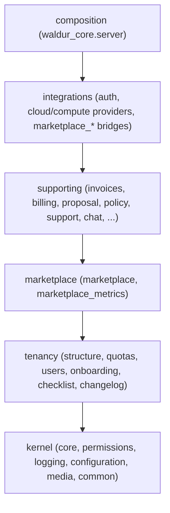

# Modularization and Dependency Boundaries (`tach`)

Waldur MasterMind uses [`tach`](https://docs.gauge.sh/) to enforce static module
boundaries across all Django apps and packages under `src/` with zero runtime
overhead.

Configuration lives in `tach.toml` at the repository root and is checked
automatically in pre-commit (`tach-check`) and GitLab CI
(`Check module boundaries`).

## Why `tach`

- **Freeze the dependency graph**: every package under `src/` is declared in
  `tach.toml` (`root_module = "forbid"`), so new untracked packages and
  accidental cross-app imports fail CI immediately.
- **No config rot (`exact = true`)**: removing the last import of a dependency
  also requires removing it from `depends_on` in `tach.toml`, locking in every
  decoupling win permanently.
- **No Django bypasses**: `include_string_imports = true` and
  `ignore_type_checking_imports = false` catch lazy string references and
  `if TYPE_CHECKING:` imports.
- **Disciplined exceptions**: `[rules]` sets both
  `unused_ignore_directives = "error"` and
  `require_ignore_directive_reasons = "error"`, so every `# tach-ignore` must
  carry a reason (such as a ticket ID) and cannot outlive the import it
  suppresses.
- **Public interfaces (`[[interfaces]]`)** and **layers (`layers`)**: ready to
  be enabled incrementally as cycles are burned down.

## Everyday Commands

```bash
# Validate all module boundaries (same check as CI and pre-commit)
uv run tach check

# Inspect every file and line creating a dependency from a module
uv run tach report src/waldur_mastermind/invoices
uv run tach report src/waldur_core/structure --dependencies -d waldur_mastermind.marketplace

# Update tach.toml after intentionally adding or removing a dependency
# (review the diff carefully; never add new upward dependencies!)
uv run tach sync

# Visualize the module dependency graph as Mermaid
uv run tach show --mermaid -o -

# Run only tests impacted by changes relative to develop
uv run tach test --base origin/develop
```

## Target Layer Architecture

Modules in `tach.toml` are grouped top-to-bottom into six target layers.
Higher layers may depend on lower layers; lower layers must not depend on
higher layers:



`waldur_core` (version metadata) and `waldur_core.core` (shared mixins, base
views/serializers/models) are marked `utility = true`, so all modules may
import them without repeating them in `depends_on`, while `waldur_core.core`'s
own `depends_on` list remains strictly enforced.

Migrations (`**/migrations/`) and tests (`**/tests/`) are excluded from
boundary enforcement so historical migrations and cross-app test fixtures do
not distort production boundaries.

## Incremental Rollout Plan

### Phase 1: Baseline (completed)

- All 66 packages under `src/` are declared in `tach.toml` with `exact = true`
  and `root_module = "forbid"`.
- CI job `Check module boundaries` and pre-commit hook `tach-check` block any
  new undeclared cross-module import.
- Upward layer dependencies are annotated in `tach.toml` with
  `# Upward dependencies (modularization debt; do not add new ones):` so
  reviewers spot regressions immediately.

### Phase 2: Burn Down Upward Cycles (in progress)

Progress:
- **Wave 1 — Composition layer sealed (`waldur_core.server` `visibility = []`)**:
  all 7 upward edges into `waldur_core.server` have been eliminated, freeing
  `waldur_core.server`, `waldur_core.changelog`, `waldur_mastermind.feedback`,
  and `waldur_sram` from the main dependency cycle and permanently preventing
  any module under `src/` from importing `waldur_core.server`.
- **Wave 2 — Kernel decoupled from business apps and auth integrations**: all 6
  upward edges from `waldur_core.core`, `waldur_core.logging`, and
  `waldur_core.permissions` into `waldur_mastermind.*` and `waldur_auth_social`
  have been eliminated (zero `kernel -> waldur_mastermind.*` or
  `kernel -> integrations` dependencies remain).
- **Wave 3 — Tenancy quick wins (`waldur_core.users` and `waldur_core.structure`)**:
  all 8 upward edges from `waldur_core.users` (`waldur_auth_social`,
  `waldur_freeipa`, `waldur_mastermind.marketplace`) and `waldur_core.structure`
  (`waldur_auth_social`, `billing`, `invoices`, `marketplace_metrics`,
  `marketplace_remote`) have been eliminated (`waldur_core.users` now has zero
  upward dependencies).

Current snapshot (excluding `migrations/` and `tests/`, with `waldur_core.core`
as a utility module): 66 modules, 314 declared edges, of which **24 edges
across 6 modules** remain as upward layer violations (60 modules already
respect the target layer order):

| Module | Target Layer | Upward Edges | Upward Targets |
| --- | --- | --- | --- |
| `waldur_mastermind.marketplace` | `marketplace` | 15 | `analytics`, `billing`, `invoices`, `matrix_chat`, `notifications`, `policy`, `promotions`, `proposal`, `support`, `marketplace_openstack`, `marketplace_rancher`, `marketplace_site_agent`, `waldur_freeipa`, `waldur_openstack`, `waldur_pid` |
| `waldur_core.core` | `kernel` | 3 | `changelog`, `structure`, `users` |
| `waldur_core.structure` | `tenancy` | 2 | `marketplace`, `proposal` |
| `waldur_mastermind.chat` | `supporting` | 2 | `waldur_firecrest`, `waldur_openstack` |
| `waldur_core.logging` | `kernel` | 1 | `structure` |
| `waldur_core.permissions` | `kernel` | 1 | `structure` |

Workflow for burning down remaining edges:

1. Pick one upward edge from the table above and inspect its exact import sites:
   ```bash
   uv run tach report src/waldur_core/permissions --dependencies -d waldur_mastermind.marketplace
   ```
2. Decouple via Django signals, extension hooks/registries, or dependency
   inversion so the higher layer registers its behavior into the lower layer.
3. Delete the edge from `tach.toml` (`exact = true` will remind you as soon as
   the last import is gone).

### Phase 3: Deprecate Remaining Debt & Introduce Public Interfaces

- Mark edges under active removal as deprecated in `tach.toml` so CI emits
  warnings for every remaining import without blocking unrelated work:
  ```toml
  depends_on = [
      "waldur_core.structure",
      { path = "waldur_mastermind.invoices", deprecated = true },
  ]
  ```
- When exposing a module facade via `[[interfaces]]`, if a handful of legacy
  imports remain, suppress them inline with a mandatory reason/ticket reference:
  ```python
  # tach-ignore(WAL-1234: migrate caller to marketplace facade)
  from waldur_mastermind.marketplace.models import Resource
  ```
- Restrict external imports to the facade once ready:
  ```toml
  [[interfaces]]
  from = ["waldur_mastermind.marketplace"]
  expose = [
      "services.*",
      "events.*",
      "contracts.*",
  ]
  ```

### Phase 4: Enforce Layers and External Dependencies

1. Once all 45 upward edges are eliminated, uncomment `layers = [...]` in
   `tach.toml` and assign `layer = "..."` on each `[[modules]]` entry to make
   upward dependencies structurally impossible.
2. Configure `[external]` renames/exclusions in `tach.toml` and enable
   `tach check-external` in CI to keep `pyproject.toml` dependencies aligned
   with actual imports.

## Adding a New Django App or Package

Because `root_module = "forbid"` is enabled, any new package under `src/` must
be added as a `[[modules]]` entry in `tach.toml` under its target layer section
with its explicit `depends_on` list (avoiding upward dependencies).
