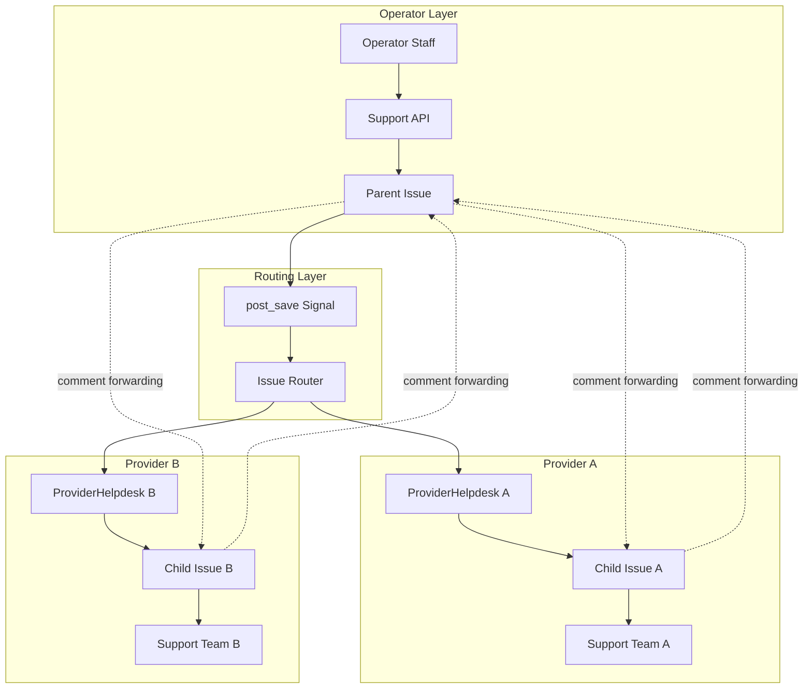
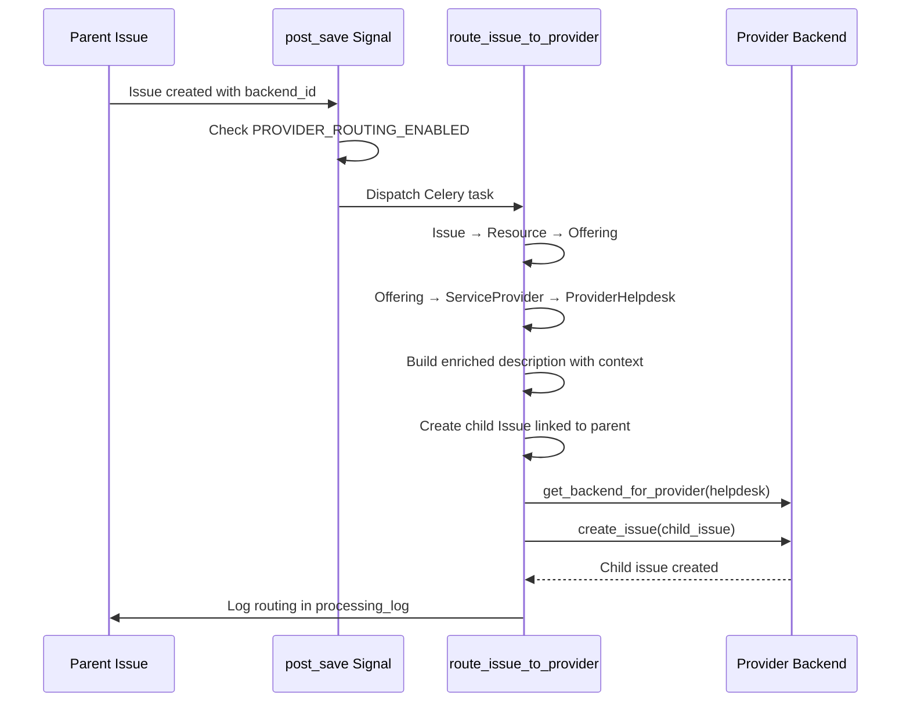
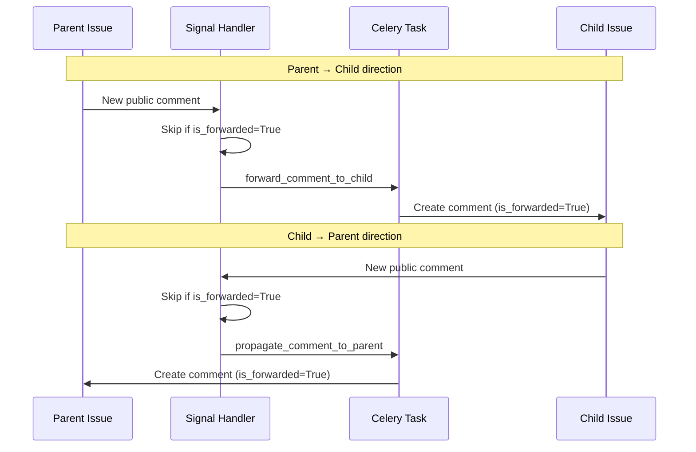

# Provider Helpdesk System

The provider helpdesk extends Waldur's single-tenant support module into a multi-tenant system. Service providers register their own helpdesk backends, tickets are automatically routed to the correct provider, and bidirectional communication flows between operator and provider via parent/child issue pairs.

For the base support module, see [Support Module Documentation](support.md).

## Architecture



## Models

### ProviderHelpdesk

Links a marketplace `ServiceProvider` to a helpdesk backend. Each provider can have one helpdesk.

| Field | Type | Description |
|-------|------|-------------|
| `service_provider` | OneToOne FK | Link to `marketplace.ServiceProvider` |
| `backend_type` | CharField | `basic`, `email`, `atlassian`, `zammad`, or `smax` |
| `settings` | JSONField | Backend-specific configuration |
| `is_active` | BooleanField | Whether routing is enabled (default: `True`) |
| `webhook_secret` | CharField | Secret for webhook validation |
| `notification_email` | EmailField | Primary notification email |
| `notify_on_new_ticket` | BooleanField | Notify on new routed tickets (default: `True`) |
| `notify_on_comment` | BooleanField | Notify on customer comments (default: `True`) |
| `notify_on_escalation` | BooleanField | Notify on escalations (default: `True`) |
| `notify_on_sla_warning` | BooleanField | Notify on SLA warnings (default: `True`) |
| `last_health_check` | DateTimeField | Timestamp of last connectivity check |
| `last_health_status` | CharField | Result of last health check |
| `failed_routing_count` | PositiveIntegerField | Counter for failed routing attempts |

### ProviderSupportUser

Team members who handle tickets for a provider helpdesk.

| Field | Type | Description |
|-------|------|-------------|
| `provider_helpdesk` | FK | Link to `ProviderHelpdesk` |
| `user` | FK | Link to Waldur `User` |
| `role` | CharField | `agent` or `manager` |
| `is_active` | BooleanField | Default: `True` |
| `skills` | JSONField | List of skill tags for routing |
| `max_open_tickets` | PositiveIntegerField | Capacity limit (default: 20) |

Unique constraint on `(provider_helpdesk, user)`. Provides `open_ticket_count` and `has_capacity` properties.

### ProviderCannedResponse

Template responses scoped to a provider helpdesk. Supports Django template syntax via `render(context_dict)`.

### IssueStatusTransition

Defines allowed status transitions for issues. When the table is empty, all transitions are allowed (backwards compatibility). When populated, only listed transitions are permitted.

### IssueTag

Simple name/color tag model for issue categorization. Color stored as hex (e.g., `#FF0000`).

### IssueLink

Links between issues with typed relationships: `related`, `blocked_by`, or `duplicates`. Unique constraint on `(source, target)`.

### SavedFilter

User-scoped saved filter configurations. Stores filter parameters as JSON. Can be shared with all staff/support users via `is_shared` flag.

### CannedResponse (operator-level)

Template responses available to operator staff. Same template rendering as `ProviderCannedResponse` but not scoped to a provider.

### New fields on Issue

| Field | Purpose |
|-------|---------|
| `parent_issue` | Self FK linking child issues to their parent |
| `provider_helpdesk` | FK to the `ProviderHelpdesk` handling this issue |
| `provider_assignee` | FK to `ProviderSupportUser` assigned to the issue |
| `is_escalated` | Whether the issue has been escalated |
| `escalated_at` | Timestamp of escalation |
| `escalation_reason` | Text reason for escalation |
| `first_response_deadline` | SLA deadline for first response |
| `resolution_deadline` | SLA deadline for resolution |
| `first_response_at` | Timestamp of first support response |
| `sla_breached` | Whether SLA has been breached |
| `tags` | M2M to `IssueTag` |

### New field on Comment

| Field | Purpose |
|-------|---------|
| `is_forwarded` | Marks comments copied between parent/child issues |

### New field on Attachment

| Field | Purpose |
|-------|---------|
| `is_public` | `False` for a file from an internal note. It is never forwarded, and only staff and whoever attached it see it |
| `is_forwarded` | Marks attachments copied between parent/child issues |
| `forwarded_from` | The attachment a copy was made from. Unique per issue, so a file reaches each ticket once |

## Ticket Routing

### Flow

When an issue is created and routing is enabled, the system resolves the provider chain and creates a child issue.



### Resolution chain

1. `dispatch_routing_on_issue_create` signal handler fires on `Issue` post_save
2. Checks `WALDUR_SUPPORT_PROVIDER_ROUTING_ENABLED` is `True`
3. Skips child issues (already routed) and issues without `backend_id`
4. `route_issue_to_provider` Celery task resolves: Issue -> resource -> `Offering` -> `ServiceProvider` -> `ProviderHelpdesk`
5. Creates a child issue with enriched description (customer, project, resource context)
6. Calls `create_issue()` on the provider backend
7. Retries up to 3 times on failure, increments `failed_routing_count`
8. Once the child is committed, `forward_parent_attachments` copies the parent's attachments to it (see [Attachment Forwarding](#attachment-forwarding))

Manual routing (`route_to_provider`) and `reroute` create the child issue the same way, attachments included.

## Comment Forwarding

Bidirectional comment forwarding maintains communication between operator and provider.



The `is_forwarded` flag prevents infinite loops: forwarded comments are skipped by all signal handlers.

Forwarding happens only when a comment is created, and a copy keeps no link to its original, so editing or deleting a comment does not reach its copies. For that reason the author of a comment cannot edit or delete it once the ticket has a parent or child issue, or when the comment is itself a forwarded copy. Staff still can, but their changes are not forwarded either.

## Attachment Forwarding

Attachments travel between the parent and its child issues the way public comments do.

- **On routing**, manual routing and reroute, `forward_parent_attachments` copies the parent's attachments to the new child once the child is committed. The request that routes the ticket does not wait for the files. On a reroute, the files a previous provider sent back stay on the parent and are not passed to the next provider, just as that provider's comments are not. The withdrawn child's stored files are deleted with it.
- **After routing**, a file added to the parent is forwarded to its child issues (`forward_attachment_to_child`), and a file added to a child is propagated to the parent (`propagate_attachment_to_parent`). The handler schedules the forwarding whenever a file lands on a ticket that is not itself a child, and the task looks the children up, so a file uploaded while routing is still creating the child is not lost. A file lands when its row is created with it, as an API upload is, or when a later save adds it, which is how the Zammad, SMAX and Atlassian syncs store what they pull in. Other saves cost nothing. For a new file, one query asks whether any helpdesk is active or holds a child of the ticket, and nothing is scheduled if none does.
- **One copy per ticket.** A copy records its original in `forwarded_from`, and `(issue, forwarded_from)` is unique. Routing and forwarding can race, and a task can run twice or be retried, without making a second copy. Copies are also marked `is_forwarded=True` and are never forwarded again. The flag stays when the original is deleted, which clears `forwarded_from`.
- **Internal files stay.** A file from an internal note has `is_public=False` and is not forwarded, just as the note is not. The Zammad sync sets it from the article. SMAX and Jira hold attachments on the ticket, not on a comment, and say nothing about their visibility, so files they sync count as public. The attachments API and `/api/media/` show such a file only to staff and to whoever attached it, as the comments API does with internal comments.
- **Every copy is pushed** to the backend that owns its ticket: the provider's backend for a child, the operator's backend for the parent. Comments copied back to the parent are not pushed, but an attachment has to be. The remote service desks' sync deletes attachments the desk does not hold, so an unpushed copy would disappear from the parent.
- **Each copy has its own stored file**, so deleting or erasing an attachment leaves its copies readable.
- **Committed, then pushed.** A copy is committed in `CREATION_SCHEDULED`, with a placeholder `backend_id`, before it is pushed. A push runs in three steps so that no transaction is open while the desk is called. It claims the copy (`CREATING`, counting `push_attempts`) in a short transaction, calls the desk, and records the result in another. The claim is the row's `modified`: the result is recorded only while the row still holds it, and the backend's own save of a copy being pushed writes only `backend_id` and `backend_name`. A claim lapses after twice `CELERY_TASK_TIME_LIMIT`, by which time Celery has killed any push still running. A desk that hands back an id has taken the file. If saving the id fails after that, the copy is recorded as pushed rather than sent again, and becomes `ERRED` if recording fails too. If even that cannot be written, a copy whose desk id reached its row is recognised as pushed on the next attempt. A desk that returns without an id has taken nothing, which counts as a failure. Until it is pushed, a copy is shown only to staff, and the syncs do not delete it as stale.
- **A file a backend refuses** does not stop the routing. The task retries up to 3 times, a minute apart, and each retry pushes only the copies still waiting. After the last retry, the failure is logged and an `attachment_not_forwarded` entry, naming the waiting copy, is added to the parent's `processing_log`. From then on the periodic `retry_attachment_forwarding` task, every 15 minutes, pushes again the copies left waiting for 15 minutes, and those whose claim has lapsed, at most 100 a run. It does nothing where no ticket was ever routed; a ticket counts as routed by its parent or by its helpdesk, so the copies of a child whose parent was deleted are still pushed. A copy deleted during a run is skipped. After 24 pushes, a copy is given up as `ERRED` and noted with the reason `given_up`. A desk that took the file without Waldur learning so, because the connection dropped before the desk's id was saved or the worker died mid-push, may be sent the file again.
- **SMAX** uploads a file under its author, and a file with no author, such as the purchase order of a marketplace order, under the ticket's reporter. With neither, it refuses the file.

Each provider helpdesk files the attachments of its tickets under a `backend_name` of its own, `<backend_type>:<helpdesk uuid>`. Every desk numbers attachments from its own sequence, so two providers on Jira, or a provider and the operator, hand out the same ids, while `(backend_name, backend_id)` is unique. That covers copies, uploads, and the files a sync pulls into a provider's ticket. Deleting an attachment of a routed ticket, and asking whether it may be deleted, goes to that helpdesk's backend, and so do changes to its comments. The Zammad and SMAX backends also delete a file an earlier sync filed under the plain name.

The syncs match a desk's attachments to a ticket's by id within that ticket, whatever name they are filed under, and skip an id another ticket already holds. They delete as stale only what the desk filed, under either name. A provider helpdesk with no settings of its own shares the operator's desk, and the operator's sync then syncs the provider's tickets as well, so it must recognise their copies.

### The operator's sync and webhooks

The operator's periodic sync (SMAX, Jira) and its webhooks (SMAX, Jira, Zammad) ask the operator's own server. They leave alone the tickets routed to a provider helpdesk of another type or on another desk, where the same id names another ticket, and the children of a deleted helpdesk. Those tickets are left to the provider's own channel, the provider webhook. A helpdesk shares the operator's desk when `get_backend_for_provider` would connect it to the same one. That means the same backend type and the same `desk_settings`: the API URL, and for SMAX also the tenant, since SMAX ids are per tenant. They are read from the helpdesk's settings through `provider_settings_override`, with the operator's as the fallback, without building a backend. URLs are compared by scheme, host and port, ignoring case and the default port, and by path without a trailing slash; an IPv6 host keeps its brackets. A helpdesk whose settings cannot be read counts as on another desk. Under `provider_settings_override`, a helpdesk that gives none of the connection settings uses the operator's. One that names the operator's URL with its own credentials still shares the desk. The Zammad webhook now also looks only at Zammad tickets (`backend_name`).

### Children of a deleted helpdesk

Deleting a provider helpdesk leaves its child tickets without one, and their desk is no longer known. `get_backend_for_issue` raises for such a ticket instead of falling back to the operator's desk, where its id names another ticket. `find_backend_for_issue` returns None. Files and comments can no longer be added there, and comments can no longer be changed or deleted: the API answers 400, and the availability flags read false. Staff, and only staff, may delete a file there. The delete removes the row and its stored file from Waldur only: no desk is asked, and any copy on the provider's helpdesk stays. The attachment's `delete_is_local_only` says so, so the UI can warn. Nothing is forwarded to or from such a ticket. Copies still on their way to it are marked `ERRED` with the reason `helpdesk_deleted`.

Active agents of the provider helpdesk can list and download the attachments of the tickets routed to them. Like comments, edits and deletions are not forwarded.

## Escalation

1. User calls `POST /api/support-issues/{uuid}/escalate/` with `reason`
2. Issue fields updated: `is_escalated=True`, `escalated_at`, `escalation_reason`
3. Escalation comment `[ESCALATED] {reason}` created on the issue
4. Comment forwarding propagates to child issues automatically
5. `notify_provider_escalation` task sends email to provider

**Permissions:** Issue caller (the person who created the ticket), staff, or support users.

## SLA Management

### Configuration

| Setting | Default | Description |
|---------|---------|-------------|
| `WALDUR_SUPPORT_SLA_RESPONSE_HOURS` | 4 | Hours until first response deadline |
| `WALDUR_SUPPORT_SLA_RESOLUTION_HOURS` | 24 | Hours until resolution deadline |

### Behavior

The `BasicBackend` sets SLA deadlines on issue creation based on `created + configured hours`. When a support user adds the first comment to an issue, `first_response_at` is recorded.

### Monitoring

Two periodic Celery tasks monitor SLA compliance:

- **`check_sla_breaches`** (every 15 min): Marks issues as `sla_breached=True` when response or resolution deadlines pass without the corresponding action
- **`check_sla_warnings`** (every 30 min): Logs warnings and notifies providers for issues within 1 hour of deadline

## Auto-Assignment

### Configuration

| Setting | Default | Description |
|---------|---------|-------------|
| `WALDUR_SUPPORT_AUTO_ASSIGN` | `False` | Enable automatic ticket assignment |
| `WALDUR_SUPPORT_AUTO_ASSIGN_STRATEGY` | `least_loaded` | Assignment algorithm |

### Strategies

- **`least_loaded`**: Assigns to the active `ProviderSupportUser` with fewest open tickets who still has capacity (`open_ticket_count < max_open_tickets`)
- **`round_robin`**: Cycles through active users using a cache-based counter

## Per-Provider Backend Configuration

Each `ProviderHelpdesk` stores backend-specific settings in its `settings` JSON field. The factory function `get_backend_for_provider()` creates a backend instance configured from these settings.

```python
# Example: Atlassian backend settings for a provider
provider_helpdesk.settings = {
    "server": "https://provider-jira.example.com",
    "username": "provider-bot",
    "password": "secret",
    "project_key": "PROV",
    "verify_ssl": True,
}
```

Each backend implements `from_settings(settings_dict)` classmethod and `_get_config(key, default)` that falls back to global Constance settings when a per-provider key is missing. This means a provider with no custom settings uses the operator's global backend configuration.

## API Endpoints

### Provider Helpdesk Management

| Endpoint | Method | Description |
|----------|--------|-------------|
| `/api/provider-helpdesks/` | GET | List provider helpdesks |
| `/api/provider-helpdesks/` | POST | Register helpdesk for a service provider |
| `/api/provider-helpdesks/{uuid}/` | GET/PATCH/DELETE | Manage helpdesk |
| `/api/provider-helpdesks/{uuid}/validate/` | POST | Test backend connectivity |

### Provider Ticket Portal

| Endpoint | Method | Description |
|----------|--------|-------------|
| `/api/provider-tickets/` | GET | List tickets routed to provider |
| `/api/provider-tickets/{uuid}/` | GET | Retrieve ticket details |
| `/api/provider-tickets/{uuid}/comment/` | POST | Add comment to ticket |
| `/api/provider-tickets/{uuid}/resolve/` | POST | Resolve ticket |
| `/api/provider-tickets/{uuid}/assign/` | POST | Assign to team member |
| `/api/provider-tickets/{uuid}/claim/` | POST | Claim ticket for self |
| `/api/provider-tickets/{uuid}/customer_context/` | GET | Get caller/resource context |
| `/api/provider-tickets/{uuid}/stats/` | GET | Provider-scoped statistics |

### Provider Team Management

| Endpoint | Method | Description |
|----------|--------|-------------|
| `/api/provider-support-users/` | GET/POST | List/create team members |
| `/api/provider-support-users/{uuid}/` | GET/PATCH/DELETE | Manage team member |
| `/api/provider-support-users/{uuid}/team_workload/` | GET | View team workload |

### Provider Canned Responses

| Endpoint | Method | Description |
|----------|--------|-------------|
| `/api/provider-canned-responses/` | GET/POST | List/create |
| `/api/provider-canned-responses/{uuid}/` | GET/PATCH/DELETE | Manage |
| `/api/provider-canned-responses/{uuid}/render/` | POST | Render template with context |

### Operator Productivity

| Endpoint | Method | Description |
|----------|--------|-------------|
| `/api/support-issue-tags/` | GET/POST | Manage issue tags |
| `/api/support-issue-links/` | GET/POST | Manage issue links |
| `/api/support-saved-filters/` | GET/POST | Saved filter management |
| `/api/support-canned-responses/` | GET/POST | Operator canned responses |
| `/api/support-canned-responses/{uuid}/render/` | POST | Render template |

### Issue Enhancements

| Endpoint | Method | Description |
|----------|--------|-------------|
| `/api/support-issues/{uuid}/escalate/` | POST | Escalate issue to provider |
| `/api/support-issues/bulk_update/` | POST | Bulk update issues |

### Dashboard and Health

| Endpoint | Method | Description |
|----------|--------|-------------|
| `/api/helpdesk-stats/` | GET | Helpdesk statistics |
| `/api/helpdesk-health/` | GET | Provider connectivity status |

### Provider Webhook

| Endpoint | Method | Description |
|----------|--------|-------------|
| `/api/support-provider-webhook/{uuid}/{backend_type}/` | POST | Unauthenticated webhook, validated via `X-Webhook-Secret` header |

## Permissions

| Resource | Who can access |
|----------|---------------|
| Provider Helpdesk CRUD | Customer owners of the provider's customer, staff |
| Provider Tickets | `ProviderSupportUser` members of the helpdesk, customer owners, staff |
| Provider Team | Customer owners of the provider, staff |
| Issue Tags, Links, Canned Responses, Saved Filters | Staff and support users |
| Escalation | Issue caller, staff, support users |
| Helpdesk Stats/Health | Staff and support users |

## Celery Tasks

### Scheduled

| Task | Schedule | Description |
|------|----------|-------------|
| `check_sla_breaches` | Every 15 min | Mark breached SLA deadlines |
| `check_sla_warnings` | Every 30 min | Log warnings for approaching deadlines |

### On-demand

| Task | Trigger | Description |
|------|---------|-------------|
| `route_issue_to_provider` | Issue creation | Route issue to provider helpdesk |
| `forward_comment_to_child` | Comment on parent | Forward comment to child issues |
| `propagate_comment_to_parent` | Comment on child | Propagate comment to parent issue |
| `forward_parent_attachments` | Routing complete | Copy the parent's attachments to the new child |
| `forward_attachment_to_child` | Attachment on parent | Forward attachment to child issues |
| `propagate_attachment_to_parent` | Attachment on child | Propagate attachment to parent issue |
| `notify_provider_new_ticket` | Routing complete | Email provider about new ticket |
| `notify_provider_customer_comment` | Customer comment | Email provider about comment |
| `notify_provider_sla_warning` | SLA check | Email provider about SLA warning |
| `notify_provider_escalation` | Escalation | Email provider about escalation |

## Management Commands

| Command | Description |
|---------|-------------|
| `check_provider_helpdesks` | Test connectivity of all active provider helpdesks |
| `retry_failed_routing` | Retry routing for issues that failed (supports `--dry-run`) |
| `helpdesk_stats` | Display helpdesk statistics summary |

## Constance Settings

| Setting | Type | Default | Description |
|---------|------|---------|-------------|
| `WALDUR_SUPPORT_PROVIDER_ROUTING_ENABLED` | bool | `False` | Enable automatic ticket routing to providers |
| `WALDUR_SUPPORT_AUTO_ASSIGN` | bool | `False` | Enable auto-assignment of tickets |
| `WALDUR_SUPPORT_AUTO_ASSIGN_STRATEGY` | str | `least_loaded` | Assignment strategy |
| `WALDUR_SUPPORT_SLA_RESPONSE_HOURS` | int | `4` | Hours until first response SLA deadline |
| `WALDUR_SUPPORT_SLA_RESOLUTION_HOURS` | int | `24` | Hours until resolution SLA deadline |

## Implementation Files

| File | Purpose |
|------|---------|
| `support/models.py` | New models and new fields on Issue/Comment/Attachment |
| `support/views.py` | ViewSets for all new endpoints |
| `support/serializers.py` | Serializers for all new endpoints |
| `support/filters.py` | Filters for new models |
| `support/urls.py` | URL routing |
| `support/tasks.py` | Celery tasks for routing, forwarding, SLA, notifications |
| `support/handlers.py` | Signal handlers for routing and forwarding |
| `support/utils.py` | Helper functions (stats, context building) |
| `support/backend/__init__.py` | `get_backend_for_provider()` factory |
| `support/backend/basic.py` | Enhanced BasicBackend with SLA and auto-assign |
| `support/backend/email_backend.py` | Email-based provider backend |
| `support/management/commands/` | `check_provider_helpdesks`, `retry_failed_routing`, `helpdesk_stats` |
| `support/templates/support/` | Email notification templates |

All paths are relative to `src/waldur_mastermind/`.
